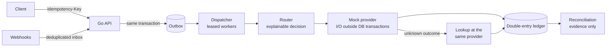

# Railvanta

**A sandbox payment orchestration platform that makes payment failures reproducible and shows the guarantee that handles each one.**

Go API · Next.js dashboard · SQLite · Playwright. Deterministic mock provider only: **no real money moves**.

[](https://www.youtube.com/watch?v=KyC8T2YNafI)

▶ **[Watch the walkthrough on YouTube](https://www.youtube.com/watch?v=KyC8T2YNafI)**: a recording of the real sandbox covering a lost response, duplicate requests, a provider outage and reconciliation.

## Why this project exists

Most hard payment bugs live in the gap between *"we sent the charge"* and *"we know what happened"*:

| What goes wrong | What Railvanta guarantees |
| --- | --- |
| A retry or double click charges the customer twice | Every create carries an `Idempotency-Key`: ten concurrent requests give one payment and nine replays, and a changed body gets `409` |
| The provider charged, but the response was lost | The payment is marked **unknown**, not failed, and is resolved only by a lookup at the **same** provider |
| The provider goes down mid-payment | The payment stays unknown and is never failed over to another provider, which could charge twice |
| The same webhook arrives several times | A webhook inbox keyed by provider event ID applies the effect once |
| A replayed job posts to the ledger twice | Posting keys leave exactly one balanced double-entry journal |
| The provider's records disagree with ours | Reconciliation records the discrepancy with evidence and never edits the books |

Each row is a scenario you can run in the sandbox, with the evidence (attempts, journals, events, discrepancies) on the dashboard.

## Try it in two minutes

```sh
pnpm install --frozen-lockfile
pnpm demo:up          # starts the Docker stack (builds images on first run; DEMO_BUILD=1 rebuilds)
```

Open <http://localhost:3000> in Chromium or Firefox. Safari does not keep `Secure` cookies on plain-http localhost.

1. **Landing page:** read *Why Railvanta exists*, watch the 3D payment lifecycle, then click **Start sandbox**. You get a session and a one-time API key, and **Run it** sends a real `POST /v1/payments`.
2. **Dashboard:** the hub's *The story: what this sandbox proves* panel lists the eight sample runs that were executed at startup, each linked to its evidence.
3. **Every page** has a one-click **Default demo**. **API reference** opens Swagger UI, and **Settings → API keys** generates sandbox keys.

`pnpm demo:down` stops the stack (add `-v` to delete the data). For a guided presentation, see the [presenter script](docs/demo/story.md) and the [demo runbook](docs/demo/README.md).

## How it works



- **Acceptance:** idempotent by key, with the request stored and replayed byte-for-byte.
- **Execution:** a leased outbox dispatcher calls the provider outside any database transaction.
- **Ambiguity:** an unknown outcome is resolved only by looking it up at the original provider, never by retrying elsewhere.
- **Money:** integer minor units, a balanced double-entry ledger with posting keys, and reconciliation that records evidence without changing the books.

More detail: [architecture](docs/architecture.md), [design decisions](docs/decisions/), [OpenAPI contract](backend/api/openapi.yaml), [documentation index](docs/README.md).

| Area | Stack |
| --- | --- |
| API | Go 1.26, GORM, SQLite (WAL), OpenAPI 3 |
| Dashboard | Next.js, React, TanStack Query, Zod, three.js, Swagger UI |
| Tests | Go tests, Vitest + Testing Library, Playwright (API, UI, accessibility, ops) |
| Runtime | Docker Compose (API, web, unprivileged Nginx proxy), optional Kubernetes manifests |

## Prerequisites

| Tool | Version |
| --- | --- |
| Node.js | 22 (`.nvmrc`) |
| pnpm | 11.3.0 (`corepack enable`) |
| Go | 1.26, plus a C compiler for the CGO SQLite driver |
| Docker with Compose v2 | recent |
| Python 3, `openssl`, `curl` | for the test harness and examples |

Run every command from the repository root.

## Install, verify and test

<!-- quickstart:start -->
```sh
pnpm install --frozen-lockfile
pnpm --filter @railvanta/e2e exec playwright install chromium
pnpm check
```
<!-- quickstart:end -->

`pnpm check` runs lint, generated-contract checks, typecheck, Go and Vitest tests and the production builds. `pnpm test:e2e` runs the full Playwright suite against an isolated API and dashboard that it starts and cleans up itself.

| Command | Purpose |
| --- | --- |
| `pnpm check` | Whole-repository gate before a PR |
| `pnpm test` | Go and frontend unit tests (`test:api` / `test:web` for one side) |
| `pnpm test:e2e` | Playwright black-box suite (`test:e2e:ci` disables retries) |
| `pnpm lint` / `pnpm typecheck` / `pnpm format` | Linters, TypeScript, formatting |
| `pnpm generate:api` / `pnpm check:generated` | Regenerate / verify frontend types from OpenAPI |
| `pnpm check:docs` | Validate every `/docs` example against the contract |

Container-mode E2E (also runs the backup/restore and container ops specs) needs a fresh volume:

```sh
docker compose -f docker-compose.yml -f docker-compose.e2e.yml up --build --detach --wait
E2E_BASE_URL=http://localhost:3000 pnpm test:e2e
docker compose down -v
```

See [e2e/README.md](e2e/README.md) for the harness details.

## Run without the demo launcher

**Docker Compose:** `pnpm compose:up` starts the stack on <http://localhost:3000> (`RAILVANTA_PORT` changes the port). `pnpm compose:logs` follows the logs, `pnpm compose:down` stops it and keeps the SQLite volume, and `docker compose down -v` deletes it. Public sandbox access is on in the loopback-only Compose files ([ADR 0013](docs/decisions/0013-public-sandbox-access-and-default-demos.md)), so **Start sandbox** works without prepared credentials.

**Natively:** run the API in demo mode on loopback, then the dashboard:

```sh
# Terminal 1: API (demo mode seeds a workspace and keys; loopback only)
export APP_ENV=sandbox DEMO_MODE=true SANDBOX_PUBLIC_ACCESS=true HTTP_ADDR=127.0.0.1:8080
export SQLITE_PATH=data/demo-$(date +%s).db
export DEMO_OPERATOR_KEY="oper.$(openssl rand -hex 16)" DEMO_READER_KEY="read.$(openssl rand -hex 16)"
export DEMO_OTHER_WORKSPACE_KEY="othr.$(openssl rand -hex 16)"
export DEMO_SESSION_TOKEN="$(openssl rand -hex 16)" DEMO_CSRF_TOKEN="$(openssl rand -hex 16)"
echo "operator key: $DEMO_OPERATOR_KEY"
pnpm dev:api

# Terminal 2: dashboard, proxying /v1/* to the API
API_INTERNAL_ORIGIN=http://127.0.0.1:8080 pnpm dev:web
```

Then create a payment with the printed key:

```sh
KEY=<operator key printed above>
curl -s -X POST localhost:3000/v1/payments \
  -H "Authorization: Bearer $KEY" -H "Idempotency-Key: demo-$(date +%s)" \
  -H "Content-Type: application/json" \
  -d '{"amount_minor":"2500","currency":"USD","payment_method_id":"00000000-0000-7000-8000-000000000121"}'
```

Other seeded methods drive the failure scenarios: `…122` decline, `…124` timeout before execution, `…125` timeout after success, `…126` outage. The `/docs` page lists runnable examples. Environment variables are documented in `backend/.env.example` and [deployment](docs/operations/deployment.md); backup, restore and the restore drill are covered there too.

## Scope and limits

- **Sandbox only:** one deterministic mock provider with simulated profiles. Real provider integrations (Stripe, Plaid) are not built.
- **Single node:** single-owner SQLite, with no horizontal API scaling or database high availability.
- **Public sandbox access is a demo convenience:** when it is on, anyone who can reach the local proxy is an operator of the shared sandbox workspace. It is off by default and in Kubernetes.
- **Labelled data:** sample runs and demo data are real simulations through the payment pipeline, labelled *Simulated*.

Changes and their verification are recorded in [CODECHANGELOG.md](CODECHANGELOG.md).
