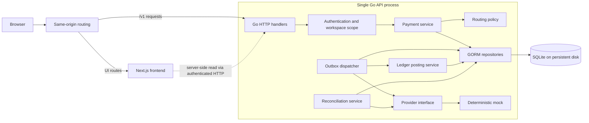

# Railvanta Architecture

## Scope and decisions

Railvanta demonstrates payment routing, durable execution, a double-entry ledger, reconciliation, and an operations dashboard on **Go, GORM, SQLite, Next.js, and Tailwind CSS** ([ADR 0001](decisions/0001-sandbox-stack.md)).

Start with a deterministic mock provider and sandbox payments. Stripe and Plaid integrations, real fund movement, Kafka, Redis, Temporal, and multiple backend services are outside the first implementation. UI controls for deferred capabilities remain visibly unavailable.

| Concern | Proposed choice | Reason / boundary |
| --- | --- | --- |
| Frontend | Next.js App Router, TypeScript, Tailwind CSS (licensed Tailwind Plus components only if available) | Server-rendered shell with interactive client components |
| Backend | One Go HTTP application with internal domain packages | Keep payment invariants inside one transaction boundary |
| Persistence | GORM with explicit SQL migrations and SQLite | Reproducible local sandbox; one writer at a time |
| Durable work | SQLite outbox plus dispatcher inside the API process | Recoverable work without a separate broker |
| Financial storage | Signed 64-bit integer minor units; one currency per journal | Avoid floating-point arithmetic |
| API money values | Decimal strings, e.g. `"25000"` | Preserve precision in JavaScript |
| Local sandbox runtime | Separate API/frontend Docker images, Compose proxy, API-only SQLite volume | Required container workflow; no cluster needed |
| Native development | Next.js dev process plus Go process and local disk | Alternative for editing/debugging and the current isolated test harness |
| Optional cluster | Frontend Deployment, single-replica API StatefulSet with persistent volume | Demonstrate Kubernetes without implying API high availability |

SQLite permits one simultaneous write transaction. WAL requires participating processes to use the same host and does not support network filesystems. Those constraints define this sandbox's scaling boundary. [SQLite transactions](https://www.sqlite.org/lang_transaction.html), [SQLite WAL](https://www.sqlite.org/wal.html).

## Proposed repository layout

```text
package.json                # pnpm monorepo root: scripts orchestrate Go and JS workspaces
pnpm-workspace.yaml         # JS workspaces: frontend, e2e, packages/*
CODECHANGELOG.md            # Record of every change and its verification
backend/                    # Go module (outside the npm graph; driven by `go -C backend`)
  cmd/api/                  # HTTP entry point and dispatcher lifecycle
  internal/
    auth/                   # Sessions, workspace membership, permissions
    payment/                # Payment and attempt transitions
    routing/                # Provider eligibility and decision reasons
    provider/               # Interface and deterministic mock adapter
    ledger/                 # Atomic journal posting and reversals
    reconciliation/         # Comparison runs and discrepancies
    event/                  # Webhook inbox, outbox, audit history
    storage/                # GORM repositories and transaction boundary
    transport/http/         # Request validation and response mapping
  migrations/               # Ordered, reviewed SQL migrations
  tests/                    # Integration, concurrency, and failure tests
frontend/                   # @railvanta/frontend workspace
  app/                      # Public, dashboard, and documentation routes
  components/               # Accessible shared and feature components
  lib/api/                  # Typed client and API error mapping
  lib/hooks/                # Queries and mutations
  tests/                    # Vitest component tests
e2e/                        # @railvanta/e2e: Playwright black-box suite
  api/                      # HTTP specs against the running Go API
  ui/                       # Browser specs against Next.js + Go
  support/                  # Harness: boot/restart/kill API, fixtures, typed client
packages/                   # Shared TS packages (e.g. OpenAPI-generated client)
infrastructure/             # Future Docker and Kubernetes configuration
docs/                       # Design documents and reference schema
```

## Component boundaries



Next.js does not open the database. Browser mutations reach Go through same-origin `/v1` routing. Authenticate and authorize every workspace operation in Go; never derive authority from a supplied workspace ID alone. Server-side requests must preserve the authenticated user's scope without exposing service credentials to client bundles. See [frontend boundaries](frontend/design.md).

## Payment execution and consistency

1. Validate authentication, permissions, currency, amount, and `Idempotency-Key` before reserving work. Canonicalize validated operation parameters for a stable request hash.
2. In one short transaction, reserve the workspace/operation/key, insert the payment and initial audit transition, append an outbox event, and persist the accepted HTTP response. A uniqueness constraint arbitrates concurrent identical requests.
3. Commit before acknowledging acceptance. Return `202` with payment ID and a location for polling. A same-key/same-payload retry returns the stored response; a changed payload returns `409`. `GET` returns current state, independently of the original acceptance snapshot.
4. The dispatcher durably claims work with an expiring lease and records an attempt plus stable provider request key before contacting the provider. Never hold a database transaction across network I/O.
5. Persist the observed outcome with a guarded state/version update. A confirmed success, its balanced journal, audit transition, and follow-up outbox event commit together.
6. A timeout or crash after possible provider acceptance creates an uncertain outcome. Recover by querying the original provider or replaying only under its documented idempotency contract. Never treat lease expiry as proof that another payment execution is safe.

Sequence diagrams and state machines are in [flows](backend/flows.md); SQLite-specific transaction and lease mechanics are in [persistence](backend/persistence.md).

GORM's transaction callback must use the transaction handle for every participating write; independent default write transactions do not make a multi-table operation atomic. [GORM transactions](https://gorm.io/docs/transactions.html).

The implementation must store durable status and provider identifiers before returning work to a queue. Neither an in-memory mutex nor a frontend disabled button is a financial concurrency guarantee.

## State and accounting rules

Payment and attempt states are defined in [flows](backend/flows.md). `unknown` is an operational uncertainty, not a decline.

- Scope all reads, unique business keys, and relationships to the authenticated workspace.
- A logical request creates at most one payment for its retained idempotency key. Keep keys throughout the sandbox dataset's lifetime; any future expiration policy must address delayed retries explicitly.
- Post each economic event once. A journal has at least two entries; debit and credit totals match in one currency. Bound and validate sums to prevent integer overflow.
- Ledger records are append-only once posted. Corrections use linked reversal journals, never edits to historical amounts.
- Audit transitions and inbox deduplication survive restarts. Out-of-order events cannot regress terminal state.
- A routing rule may choose an alternate provider before submission or after a proven no-effect failure; uncertainty blocks automatic fallback.

The [data model](backend/data-model.md) distinguishes SQL-enforced constraints from service-enforced invariants.

## Trust, observability, and limits

For local development, use a fixed seeded workspace only in an explicit loopback-only demo mode. A public sandbox requires real sessions, workspace membership, read/operator permissions, secure cookies, CSRF protection for cookie-authenticated writes, rate limiting, and a restricted demo reset mechanism. Provider webhooks will require raw-body signature verification and a durable deduplicating inbox before external adapters are enabled.

Log correlation IDs, payment IDs, state transitions, and sanitized provider outcomes. Exclude secrets, session tokens, raw payment credentials, and sensitive request bodies. Measure request latency, dispatcher lag, unknown outcomes, reconciliation discrepancies, database busy errors, and WAL growth. Mark every seeded or simulated dashboard series.

The SQLite design has downtime during some upgrades and node failures. It does not promise distributed exactly-once execution, a highly available database, or real settlement. A future PostgreSQL migration and external durable workers require a new concurrency and deployment review; they are not a configuration-only scaling switch.
