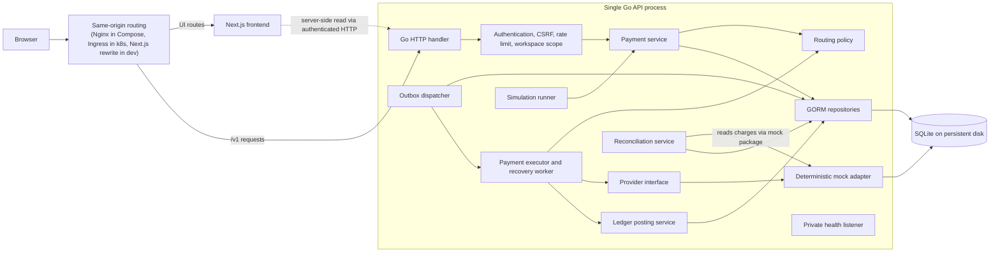

# Railvanta Architecture

## Scope and decisions

Railvanta demonstrates payment routing, durable execution, a double-entry ledger, reconciliation, and an operations dashboard on **Go, GORM, SQLite, Next.js, and Tailwind CSS** ([ADR 0001](decisions/0001-sandbox-stack.md)).

**Status: implemented (M1–M6), verified locally.** Results and their limits are in the [code changelog](../CODECHANGELOG.md) and the [verification matrix](verification-matrix.md). The system runs against one deterministic mock provider with sandbox payments only.

**Not implemented:** Stripe and Plaid adapters, real fund movement, capture and refunds, routing-rule mutation, API-key or member management in the UI, webhook signature verification (mock events are unsigned), a metrics exporter, Kafka, Redis, Temporal, additional backend services, and high availability. Dashboard controls for these are absent or shown as unavailable. Decisions that diverged from the original design are recorded as ADRs; see the [ADR index](README.md#architecture-decisions).

| Concern | Implemented choice | Reason / boundary |
| --- | --- | --- |
| Frontend | Next.js 16 App Router, TypeScript, Tailwind CSS 4, original components (no Tailwind Plus source, no `lucide-react`) | Server-rendered shell with interactive client components |
| Backend | One Go HTTP application with internal domain packages | Keep payment invariants inside one transaction boundary |
| Persistence | GORM with explicit embedded SQL migrations (0001–0005) and SQLite | Reproducible local sandbox; one writer at a time |
| Durable work | SQLite outbox plus dispatcher inside the API process | Recoverable work without a separate broker |
| Financial storage | Signed 64-bit integer minor units; one currency per journal | Avoid floating-point arithmetic |
| API money values | Decimal strings, e.g. `"25000"` | Preserve precision in JavaScript |
| Local sandbox runtime | Separate API/frontend Docker images, Compose with an unprivileged Nginx proxy, API-only SQLite volume | Required container workflow; no cluster needed |
| Native development | Next.js dev process (with a `/v1` rewrite) plus a Go process and local disk | Alternative for editing/debugging and the Playwright harness |
| Optional cluster | Kustomize manifests: web Deployment, single-replica API StatefulSet with a persistent volume. Validated offline and in k3d; never run on a managed cluster | Demonstrate Kubernetes without implying API high availability |

SQLite permits one simultaneous write transaction. WAL requires participating processes to use the same host and does not support network filesystems. Those constraints define this sandbox's scaling boundary. [SQLite transactions](https://www.sqlite.org/lang_transaction.html), [SQLite WAL](https://www.sqlite.org/wal.html).

## Repository layout

```text
package.json                # pnpm monorepo root: scripts orchestrate Go and JS workspaces
pnpm-workspace.yaml         # JS workspaces: frontend, e2e, packages/*
CODECHANGELOG.md            # Record of every change and its verification
docker-compose.yml          # proxy, api, web; docker-compose.e2e.yml adds fast timings for E2E only
backend/                    # Go module (outside the npm graph; driven by `go -C backend`)
  api/openapi.yaml          # OpenAPI contract; frontend types are generated from it
  cmd/api/                  # main.go: server, private health listener, dispatcher lifecycle
                            #   subcommands.go: `backup`, `restore`, `check`, `seed-demo`
  internal/
    config/                 # Environment loading and validation (sandbox only, loopback rules)
    auth/                   # API-key and session authentication, roles, demo seeding
    payment/                # Accept, idempotency, executor (dispatch), recovery, cancel,
                            #   outcomes (ApplySuccess/Decline/Unknown), webhook inbox, views, metrics
    routing/                # Pure provider eligibility and decisions; read-only snapshot loader
    provider/               # Provider interface, typed outcomes, health aggregation
    provider/mock/          # Deterministic durable mock adapter (owns mock_provider_charges)
    ledger/                 # Atomic journal posting, reversal, verification, explorer reads
    reconciliation/         # Evidence-only comparison runs, discrepancies, resolution history
    event/                  # Outbox dispatcher: claims, leases, retries, parking; metrics
    simulation/             # Scenario catalog and runner driving the real pipeline
    backup/                 # VACUUM INTO snapshots, manifest, restore, domain check
    storage/                # GORM models and repositories, migration runner, write-health probe
    transport/http/         # One handler (package httpapi): auth, CSRF, rate limit, routes
  migrations/               # Embedded SQL migrations 0001-0005 and embed.go
  tests/                    # Cross-package integration, concurrency, crash and isolation tests
frontend/                   # @railvanta/frontend workspace
  app/                      # layout, landing, /docs and /dashboard/** routes
  components/               # ui, layout and feature components
  lib/api/                  # Typed client, Zod schemas, generated schema.d.ts
  lib/hooks/                # TanStack Query reads and mutations
  lib/money/                # Exact minor-unit formatting
  tests/components/         # Vitest + Testing Library
e2e/                        # @railvanta/e2e: Playwright black-box suite
  api/  ui/  ops/  support/ # HTTP specs, browser specs, container-only specs, harness
infrastructure/
  docker/                   # api and web Dockerfiles, Nginx proxy config
  k8s/                      # Kustomize base, k3d overlay, example TLS secret
scripts/                    # backup, restore, restore drill, secret scan, image pins, k8s validation
docs/                       # Design documents, ADRs and the reference schema
```

`packages/*` is declared in the workspace file but the directory does not exist: the generated API types live in `frontend/lib/api/schema.d.ts`.

Provider adapters stay behind `provider.Provider`; `provider` imports no payment-domain package. `provider/mock` owns `mock_provider_charges` and exposes the read helper (`mock.ChargesByKeys`) that reconciliation uses.

## Component boundaries



Next.js does not open the database. Browser mutations reach Go through same-origin `/v1` routing. Go authenticates and authorizes every workspace operation: the workspace comes from the API key or session, never from a supplied ID. Reconciliation never calls a provider; it reads the mock's own charge rows ([ADR 0008](decisions/0008-evidence-only-reconciliation.md)). The health listener is a separate loopback-only port ([ADR 0007](decisions/0007-private-api-owned-health.md)). See [frontend boundaries](frontend/design.md).

The executor runs the mock adapter in-process through `provider.Provider`; the simulation runner calls `payment.Service.Accept` and watches persisted rows, so it injects no state of its own.

## Payment execution and consistency

1. The handler validates authentication, role, CSRF (cookie sessions), currency, amount and `Idempotency-Key`. `payment.Service.Accept` canonicalizes the operation parameters into a SHA-256 request hash.
2. In one short transaction it reserves the workspace/operation/key, inserts the payment and initial audit transition, appends a `payment.dispatch` outbox row and stores the HTTP response. A uniqueness constraint arbitrates concurrent identical requests; the loser re-reads the winner.
3. It commits before acknowledging: `202` with the payment ID and `Location`. Same key and payload replays the stored response (`Idempotent-Replayed: true`); a changed payload returns `409 idempotency_conflict`. `GET` returns current state independent of the acceptance snapshot.
4. The dispatcher claims work by compare-and-swap with a random lease token and an expiry. The executor's prepare step runs routing, a version-guarded `created -> processing` and an attempt with a stable provider key (`rv_{payment_id}_{n}`) in one transaction, then calls the provider with no transaction open.
5. The observed outcome is recorded in a new transaction with status-guarded updates. A confirmed success, its balanced journal, audit transition and outbox completion commit together.
6. A timeout or crash after possible provider acceptance leaves the attempt and payment `unknown` and enqueues `payment.lookup`. Recovery queries the original provider with the stored key, or replays at the same provider only when its adapter declares an idempotent-replay contract. Lease expiry never proves another execution is safe.

Sequence diagrams and state machines are in [flows](backend/flows.md); SQLite transaction and lease mechanics are in [persistence](backend/persistence.md).

GORM's transaction callback must use the transaction handle for every participating write; independent default write transactions do not make a multi-table operation atomic. [GORM transactions](https://gorm.io/docs/transactions.html). The store uses a single pooled connection, so a repository call through the root handle inside a transaction would deadlock; tests cover the transaction paths.

Durable status and provider identifiers are stored before work returns to the queue. Neither an in-memory mutex nor a disabled frontend button is a financial concurrency guarantee.

## State and accounting rules

Payment and attempt states are defined in [flows](backend/flows.md). `unknown` is an operational uncertainty, not a decline.

- All reads, unique business keys and relationships are scoped to the authenticated workspace.
- A logical request creates at most one payment for its retained idempotency key. Keys are kept for the dataset's lifetime; no expiration policy exists.
- Each economic event posts once (unique posting key). A journal has at least two entries; debit and credit totals match in one currency, summed with checked arithmetic.
- Ledger records are append-only once posted. A correction is a linked reversal journal (`ledger.Reverse` exists and is tested); no HTTP endpoint creates one.
- Audit transitions and webhook inbox rows survive restarts and cannot be updated or deleted. Out-of-order events cannot regress a terminal state.
- Routing may choose an alternate provider only before submission or after a proven no-effect failure. Uncertainty blocks fallback (`GuardNewAttempt`). With a single mock provider this guard is exercised by tests, not by a second live provider.

The [data model](backend/data-model.md) distinguishes SQL-enforced constraints from service-enforced invariants.

## Trust, observability, and limits

**Authentication.** API keys (`Authorization: Bearer prefix.secret`, stored as SHA-256 hashes) and expiring sessions (`__Host-railvanta_session` cookie with a hashed CSRF token and an `X-CSRF-Token` header for writes). Roles are `operator` and `reader`; writes need `operator`. A request limiter allows 600 requests per minute per remote host. `DEMO_MODE` seeds fixed fixtures only when the API binds to literal loopback; containers keep it off and use `railvanta-api seed-demo`.

**Webhooks.** `POST /v1/sandbox/webhooks/mock` is an operator-authenticated sandbox endpoint, not a public provider webhook ([ADR 0005](decisions/0005-sandbox-only-mock-webhook.md)). `webhook_inbox.signature_status` has a `verified` value, but nothing writes it: raw-body signature verification belongs to a future real adapter.

**Observability.** Structured JSON logs carry request and correlation IDs and never URLs, bodies, cookies, authorization or idempotency material. Metrics are in-process only (`event.Metrics`, `payment.ExecutionMetrics`, `payment.RecoveryMetrics`) and reset on restart; no exporter exists. Dashboard figures are observed from the database and labelled; seeded or simulated series say so.

**Limits.** SQLite means downtime during upgrades and node failure. The design does not promise distributed exactly-once execution, a highly available database or real settlement. A PostgreSQL migration and external durable workers require a new concurrency and deployment review; they are not a configuration switch. Known limitations are consolidated in the project README and the case study when published.
