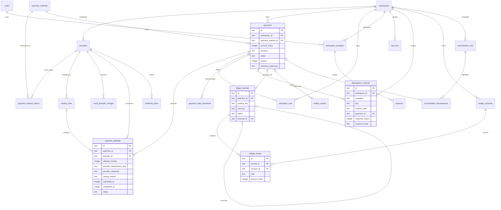

# Data Model and Entity Diagram

The [reference DDL](schema.sql) mirrors the two embedded SQL migrations in `backend/migrations/`. The startup runner installs 23 STRICT tables, including migration history. The M1 schema revisions are authorized by the implementation request; payment execution and orchestration remain later work.

## Entity relationships

The diagram shows principal relationships. Workspace foreign keys also exist on subordinate tables; composite keys enforce matching workspace and, for ledger records, currency. Consult SQL for every field and constraint.

## Representation and ownership

| Concern | Rule |
|---|---|
| IDs | Application-generated UUIDv7 strings, with optional display prefixes in the UI only. |
| Tenant | `workspace_id` comes from authenticated authorization context. Never trust the request body alone. |
| Environment | Workspace is constrained to `sandbox`; enabling real funds requires a separate design. |
| Time | All `*_at`, window, availability, and lease values are UTC Unix milliseconds stored as integers. |
| Money | Positive signed 64-bit integer minor units; never floats. Supported currency and exponent are validated by the domain layer. |
| API | Monetary values are decimal strings, e.g. `"amount_minor":"25000"`, to avoid JavaScript number precision loss. |
| Provider tokens | Opaque sandbox references only; never raw card or bank credentials. |
| Concurrency | Payment and routing `version` support compare-and-swap updates; check affected row count. |

## Table responsibilities

| Tables | Purpose and important keys |
|---|---|
| `workspaces`, `providers` | Merchant/workspace boundary; a provider code is unique per workspace. Credentials remain outside the database schema. |
| `payment_methods`, `payment_method_tokens`, `routing_rules` | Provider-neutral rail/brand/last-four metadata, provider-specific opaque tokens, and ordered amount-bounded rules. Eligibility joins a method token with an enabled rule. Rule priority is unique within a workspace/rail/currency. |
| `payments`, `payment_attempts` | Logical payment versus individual provider interaction. Persist the selected rule reference and decision reason on the attempt. Unique attempt number per payment and unique provider idempotency key. At most one unresolved attempt per payment. |
| `payment_state_transitions` | Append-only application audit, written in the same transaction as a state change. SQL validates status vocabulary, prevents changes after terminal states, and protects immutable amount/currency/workspace/method fields. The initial audit allows NULL `from_status` only for `created`; audit rows cannot be updated or deleted. The application still validates the complete legal transition graph. |
| `idempotency_records` | Unique `(workspace_id, operation, key)` plus canonical request SHA-256, accepted payment reference, and completed HTTP response. |
| `ledger_accounts`, `ledger_journals`, `ledger_entries` | Account classification, immutable posted journals, and debit/credit lines. Unique workspace posting key prevents duplicate settlement postings. |
| `webhook_inbox` | Unique provider event ID and payload hash, with duplicate count and last-delivery timestamp. Migration `0005` adds the event type, related payment and attempt, a processing `outcome` (`applied` or `ignored`) with a reason, `signature_status` (`not_applicable`, `verified`, `rejected`; only `not_applicable` is ever written for mock events), and the investigation fields `investigation_flag`, `conflicting_payload_hash` and `conflict_count`. Triggers make identity and payload immutable, forbid deletes, and keep counters and the investigation flag monotonic. Real signature verification remains an adapter responsibility; mock deliveries are not cryptographically verified. |
| `outbox_events` | Durable commands/events, due time, error and retry metadata. SQL requires a nonempty lease owner and expiry exactly while processing; the dispatcher must still compare ownership tokens. |
| `reconciliation_runs`, `reconciliation_discrepancies` | Idempotent run key and discrepancy fingerprint per run; constrained discrepancy vocabulary and required human resolution metadata. |
| `users`, `workspace_members`, `sessions`, `api_keys` | Workspace roles, expiring hashed sessions with CSRF hashes, and hashed API keys with a visible unique prefix. Session foreign keys require matching membership. |
| `mock_provider_charges`, `simulation_runs` | Durable mock evidence keyed by provider idempotency key, and persisted scenario/seed/input/result records. Only the mock adapter may own charge writes; that execution service is future work. |
| `schema_migrations` | Ordered version, filename, SHA-256 checksum, and application timestamp. Startup rejects checksum drift or a database with incompatible history. |

## Payment lifecycle

Payment and attempt states and their legal transitions are defined in [flows](flows.md#payment-state-machine). SQL validates the status vocabulary; the application validates transition order. An `unknown` outcome is never routed to a different provider, and a confirmed failed payment remains terminal.

## Ledger posting and limits

For a simplified sandbox successful payment, debit the executing provider's `provider_clearing` account (asset) and credit `merchant_payable` (liability) for the same currency and amount. This models an internal obligation, not actual bank settlement, fees, FX, or revenue recognition. Reconciliation records discrepancies without silently inventing adjustments.

The application creates a draft journal, inserts all entries, validates totals using checked arithmetic, and marks the journal posted in one transaction. SQL triggers additionally require at least two balanced lines before posting and reject insertion, modification, or deletion of posted entries and journals. Composite foreign keys prohibit mixed currency or cross-workspace entries. Aggregation overflow fails posting rather than rounding.

Corrections use a new journal with opposite sides and `reversal_of`; the application verifies that the reversal exactly offsets the original. SQL limits each original to one full reversal but does not validate the reversal's economic meaning. Consumers query only posted journals. Do not commit drafts from failed operations.

SQL does not implement authentication decisions, the complete legal state-transition graph, routing capability checks, request canonicalization, event signature verification, lease ownership comparisons, or exactly-once provider execution. These remain application invariants with tests. Embedded database file access must be restricted to the API process and controlled backup tooling.

All tables use SQLite STRICT typing. Positive integer money still has explicit business checks; SQLite may losslessly coerce numeric text, so the HTTP layer must enforce JSON string syntax separately. See [STRICT tables](https://www.sqlite.org/stricttables.html). Runtime connection PRAGMAs and transaction boundaries are absent from migration bodies; the runner owns them. An empty reference database can be built with the validation command in [persistence](persistence.md#validating-the-schema).
