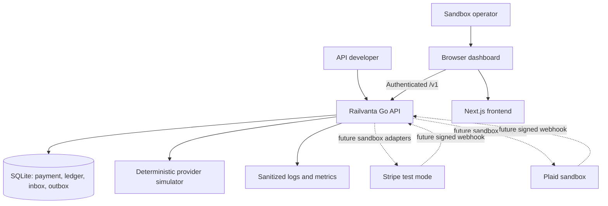
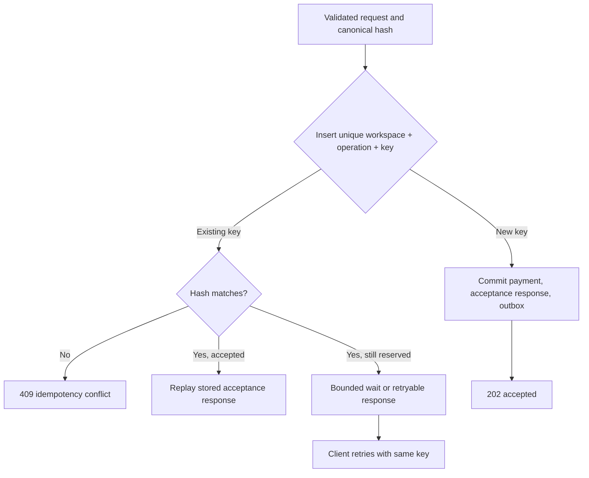
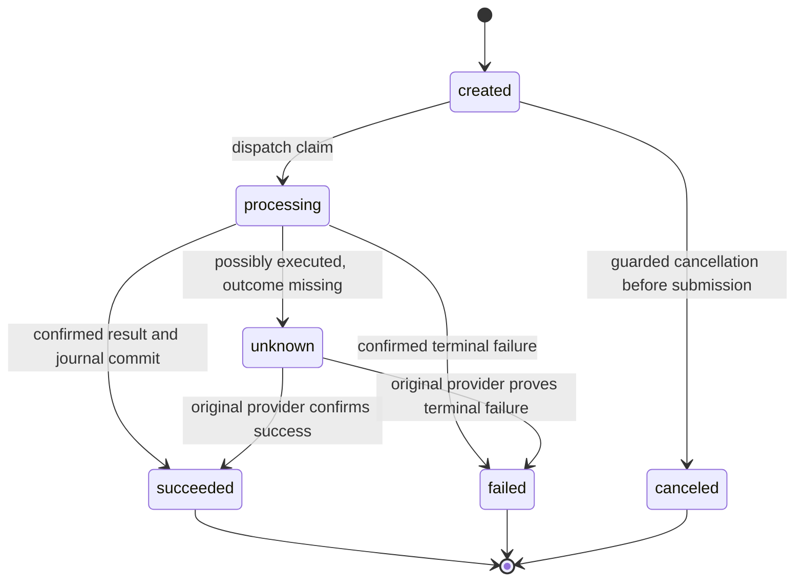
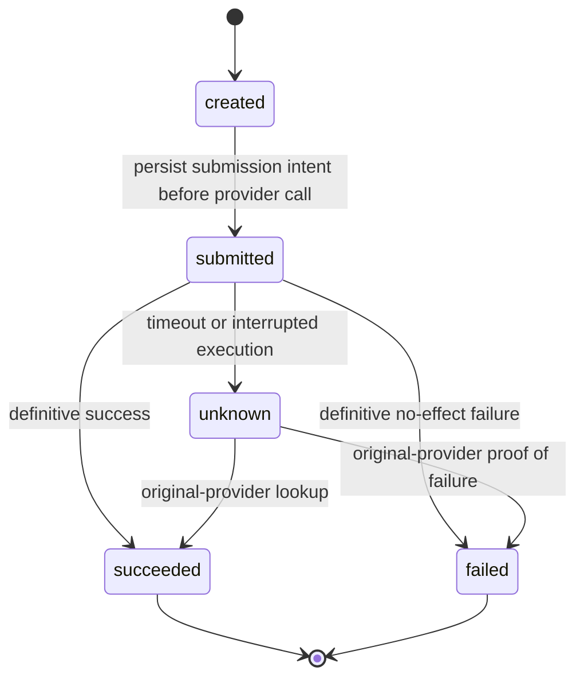
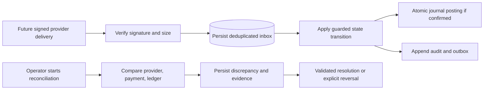

# System Flows

Runtime behavior of the Go API. This is the single home for the payment and attempt state machines. Module boundaries are in [architecture](../architecture.md), and durable records are in the [data model](data-model.md).

## System context



Solid arrows describe the first proposed implementation; dashed arrows describe deferred integrations. No real-money provider is in scope.

## Accept, dispatch, and record a payment

```mermaid
sequenceDiagram
    actor User
    participant Web as Next.js browser client
    participant API as Go API
    participant DB as SQLite
    participant Worker as In-process dispatcher
    participant Provider as Mock provider
    User->>Web: Submit sandbox payment
    Web->>API: POST /v1/payments + Idempotency-Key
    API->>API: Authenticate, authorize, validate, hash
    API->>DB: Begin short write transaction
    API->>DB: Reserve key + payment + audit + outbox + response
    DB-->>API: Commit
    API-->>Web: 202 accepted, payment ID, Location
    Worker->>DB: Claim event with lease; commit attempt and stable request key
    DB-->>Worker: Claim committed
    Worker->>Provider: Execute using stable provider key
    alt Confirmed success
        Provider-->>Worker: Success + provider reference
        Worker->>DB: Atomic guarded success + balanced journal + audit + outbox completion
    else Proven failure with no effect
        Provider-->>Worker: Definitive failure
        Worker->>DB: Record failed attempt and validated payment transition
    else Timeout or uncertain outcome
        Provider--xWorker: No trustworthy outcome
        Worker->>DB: Record unknown; schedule original-provider lookup
        Note over Worker,Provider: No automatic alternate-provider execution
    end
    Web->>API: GET /v1/payments/{id}
    API->>DB: Workspace-scoped read
    API-->>Web: Latest payment and attempt state
```

If the worker crashes after a provider call and before recording its result, recovery starts with the original attempt's durable provider key. A lease controls work ownership; it does not erase external side effects.

## Duplicate request handling



The acceptance transaction should make partially reserved records unobservable on its normal path. The retryable branch covers contention or a future explicit reservation protocol. Validation and authorization failures are not cached as accepted payments. Clients retain one key across transport retries and generate a new key only for a new logical payment.

## Payment state machine



Cancellation uses a conditional update against state/version and races with dispatch safely: only one wins. The initial MVP rejects cancellation once processing starts. Unknown outcomes stay unknown until evidence supports a terminal transition; an operator cannot clear the flag merely to retry. Refunds and reversals are separate future operations and do not rewrite a succeeded payment into a failed one.

## Attempt state machine



A stale `submitted` attempt discovered after restart is treated as potentially executed. It follows the uncertainty recovery path before another submission is considered.

## Webhooks and reconciliation



Acknowledge a valid webhook after durable inbox acceptance. Duplicate deliveries receive a successful acknowledgement without duplicate financial posting. A reconciliation run may use deterministic mock evidence in the MVP; label it simulated. It must not manufacture journals to make mismatches disappear. External webhook signature and provider lookup behavior will be specified against official provider contracts when integrations begin.

## Failure recovery checklist

| Failure point | Durable evidence | Required recovery |
| --- | --- | --- |
| Before acceptance commit | No accepted payment | Retry original key |
| After commit, before HTTP response | Stored response and payment | Replay acceptance |
| After claim, before known execution | Attempt and request key | Resolve original attempt before replay |
| Provider timeout | Unknown or stale submitted attempt | Query original provider; block fallback |
| Before success transaction commits | Attempt plus provider reference/key | Confirm outcome and atomically post once |
| Duplicate webhook/event | Unique inbox/event business key | Acknowledge or consume without another posting |
| Database busy | Transaction rolled back or result unresolved | Bounded database retry; never blindly repeat provider call |
