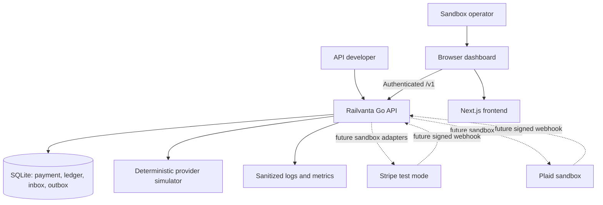
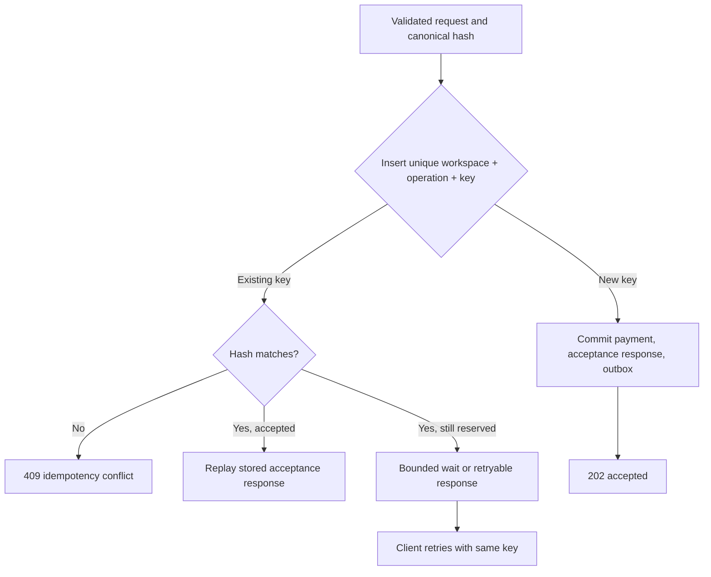
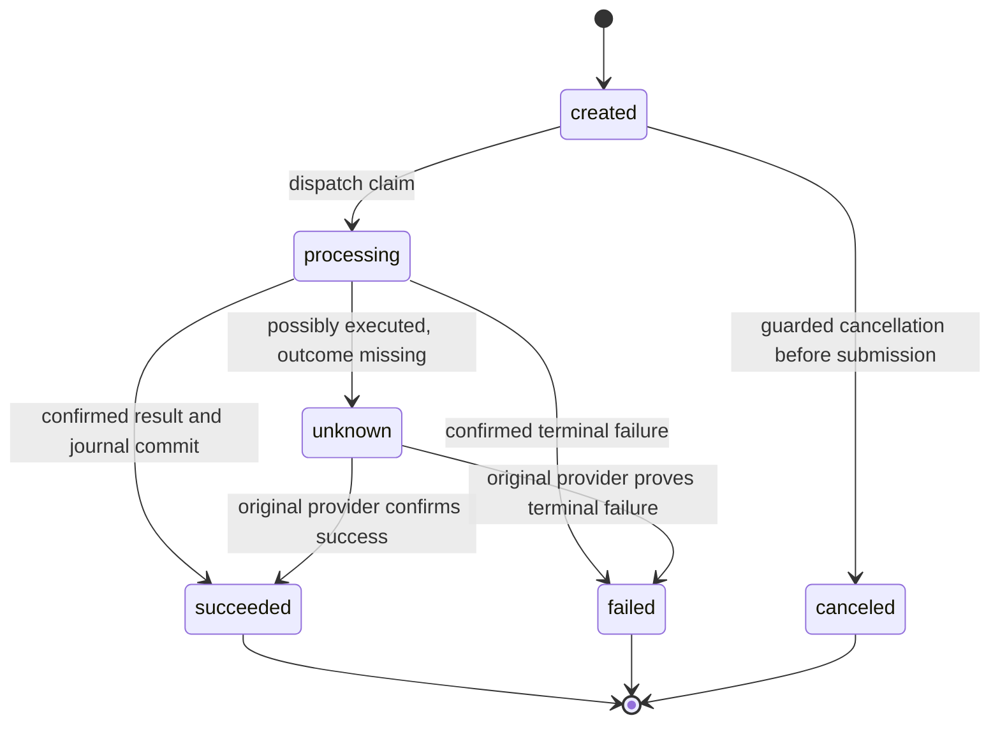
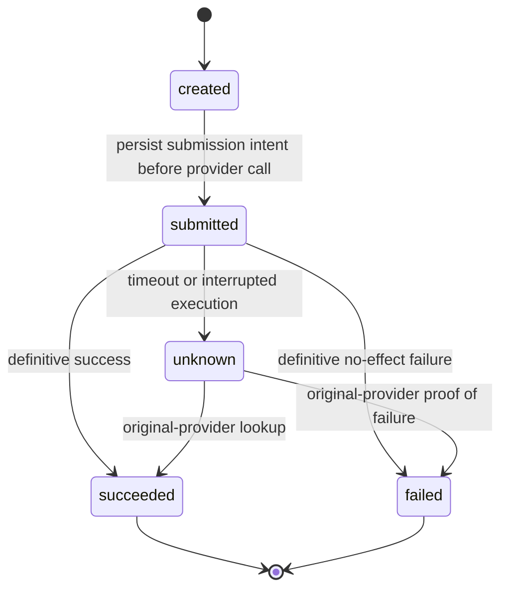
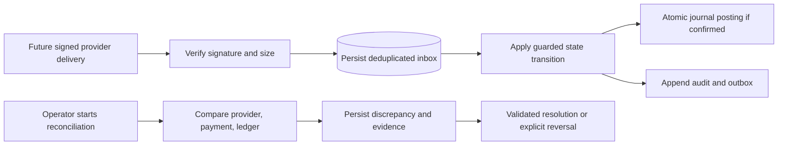

# System Flows

Runtime behavior of the Go API. This is the single home for the payment and attempt state machines. Module boundaries are in [architecture](../architecture.md), and durable records are in the [data model](data-model.md).

## System context



Solid arrows describe the first proposed implementation; dashed arrows describe deferred integrations. No real-money provider is in scope.

## Accept, dispatch, and record a payment

```mermaid
sequenceDiagram
    actor User
    participant Web as Next.js browser client
    participant API as Go API
    participant DB as SQLite
    participant Worker as In-process dispatcher
    participant Provider as Mock provider
    User->>Web: Submit sandbox payment
    Web->>API: POST /v1/payments + Idempotency-Key
    API->>API: Authenticate, authorize, validate, hash
    API->>DB: Begin short write transaction
    API->>DB: Reserve key + payment + audit + outbox + response
    DB-->>API: Commit
    API-->>Web: 202 accepted, payment ID, Location
    Worker->>DB: Claim event with lease; commit attempt and stable request key
    DB-->>Worker: Claim committed
    Worker->>Provider: Execute using stable provider key
    alt Confirmed success
        Provider-->>Worker: Success + provider reference
        Worker->>DB: Atomic guarded success + balanced journal + audit + outbox completion
    else Proven failure with no effect
        Provider-->>Worker: Definitive failure
        Worker->>DB: Record failed attempt and validated payment transition
    else Timeout or uncertain outcome
        Provider--xWorker: No trustworthy outcome
        Worker->>DB: Record unknown; schedule original-provider lookup
        Note over Worker,Provider: No automatic alternate-provider execution
    end
    Web->>API: GET /v1/payments/{id}
    API->>DB: Workspace-scoped read
    API-->>Web: Latest payment and attempt state
```

If the worker crashes after a provider call and before recording its result, recovery starts with the original attempt's durable provider key. A lease controls work ownership; it does not erase external side effects.

## Duplicate request handling



The acceptance transaction should make partially reserved records unobservable on its normal path. The retryable branch covers contention or a future explicit reservation protocol. Validation and authorization failures are not cached as accepted payments. Clients retain one key across transport retries and generate a new key only for a new logical payment.

### Implemented acceptance contract (WBS 2.1)

`payment.Service.Accept` (`backend/internal/payment/service.go`) runs one short transaction in this order: look up `(workspace_id, 'payment.create', key)`; if absent, check that the payment method belongs to the workspace and has at least one `payment_method_tokens` row; insert a `pending` idempotency record; insert the payment (`created`, version 1); insert the initial transition (`from_status` NULL → `created`); insert a `payment.dispatch` outbox row (deduplication key `payment.dispatch:{payment_id}`, payload `{"payment_id","workspace_id"}`); then complete the record with status `202` and the response body. The replay lookup runs before method validation, so a stored acceptance remains replayable.

| Situation | Response |
| --- | --- |
| New key, valid request | `202`, `Location: /v1/payments/{id}`, payment snapshot body |
| Same key, same canonical hash | Stored status and body replayed byte-for-byte, plus `Idempotent-Replayed: true` |
| Same key, different hash (amount, currency, method or merchant reference) | `409 idempotency_conflict`; the original is unchanged |
| Same key, record still `pending` (not observable on the normal path) | `409 idempotency_in_progress` with `Retry-After: 1` |
| Concurrent insert loses the unique race | Transaction rolls back and the loser re-reads the committed winner (bounded to three re-reads) |
| Method missing or in another workspace | `404 not_found`; nothing written |
| Method has no provider token | `422 payment_method_unusable`; nothing written |
| `SQLITE_BUSY` after `busy_timeout` | The whole transaction is retried up to four times with full-jitter exponential backoff (10–250 ms), then `503` with `Retry-After`; nothing committed |
| Missing or invalid header, body, amount or currency; auth or CSRF failure | `400`/`401`/`403`/`413`/`415` before the service runs; no idempotency record |

The canonical hash (`payment/idempotency.go`) covers operation, amount, currency, payment method and merchant reference, with length-prefixed fields; an absent merchant reference equals `""`. JSON field order and whitespace do not affect it. `GET /v1/payments/{id}` returns current state, so it can differ from the replayed acceptance snapshot once dispatch has moved the payment.

### Implemented dispatch contract (WBS 2.2, 2.3.5)

The in-process `event.Dispatcher` (`backend/internal/event/dispatcher.go`, `outbox.go`) claims due `outbox_events` rows of registered types only: `pending` with `available_at <= now`, or `processing` with an expired `lease_until`. Each claim is a compare-and-swap `UPDATE` that also matches the status and `lease_owner` it read, stores a fresh 32-byte `crypto/rand` token in `lease_owner`, sets `lease_until = now + DISPATCHER_LEASE` and increments `attempts`. While a handler runs, the lease is renewed every lease/3. `Renew`, `Complete`, `Release` and `Fail` all match `id`, `status = 'processing'` and the token; after another owner reclaims the row they return `event.ErrLeaseLost`. Handler errors release the row with full-jitter backoff; after 10 acquisitions it is parked as `failed`.

`payment.Executor` (`backend/internal/payment/dispatch.go`) handles `payment.dispatch`:

1. **Prepare (short transaction).** Read the payment. If `created`: route with `payment.Router` (the same code as `POST /v1/routing/evaluate`, inside the transaction), run `GuardNewAttempt`, read the method's token for the chosen provider, apply `created → processing` (version-guarded, audited), insert attempt *n* with the rule, reason and stable provider key `rv_{payment_id}_{n}`, and mark it `submitted` with `submitted_at`. Commit. If no provider is eligible: `created → processing → failed` with no attempt, and the command completes. If the payment is already `unknown`, terminal or canceled, the command completes with no effect.
2. **Provider call** with no transaction open and a `PROVIDER_TIMEOUT` deadline.
3. **Record (new transaction, busy-retried).** Every update is status-predicate guarded, and the dispatch row is completed in the same transaction (`event.Complete`); if the lease was lost, everything rolls back.

| Provider result | Attempt | Payment | Same transaction |
| --- | --- | --- | --- |
| `Succeeded` | `submitted\|unknown → succeeded`, provider reference, `completed_at` | `processing\|unknown → succeeded` (version-guarded, audited) | `ledger.PostPaymentSuccess` (debit `provider_clearing:{provider}`, credit `merchant_payable`, key `payment:{id}:success`) and outbox completion |
| `Declined` | `→ failed`, `error_code`, `completed_at` | `→ failed` | outbox completion |
| `Ambiguous` (timeout, outage, cancelled call) | `submitted → unknown`, `error_code`; `completed_at` stays NULL | `processing → unknown` | enqueue `payment.lookup` for the **same** attempt and provider, plus outbox completion |
| Dispatch reclaimed with the attempt still `submitted` (owner crashed or lost its lease) | `submitted → unknown`, `error_code = stale_submitted` | `processing → unknown` | enqueue `payment.lookup`; never resubmit, never another provider |

`ApplySuccess`, `ApplyDecline` and `ApplyUnknown` (`payment/outcome.go`) are exported for the recovery worker. Repeating a recorded outcome changes nothing (`Applied.Changed == false`). A conflicting late result returns `ErrLateOutcome` and writes nothing.

**`payment.lookup` command (consumed by WBS 2.4).** Payload `{"payment_id","workspace_id","attempt_id","provider_id","reason"}`; deduplication key `payment.lookup:{attempt_id}`, so there is one row per unresolved attempt. The handler reads `provider_idempotency_key` from the attempt row, calls `Lookup` on that provider outside any transaction, then calls `ApplySuccess` or `ApplyDecline` with its claim, or returns `event.RetryAfter(d, err)` to stay `unknown`. Until a handler is registered, these rows stay `pending`.

**Failover guard (2.2.11).** `GuardNewAttempt` rejects any new attempt while one is `created`, `submitted` or `unknown`. If the payment was ever `unknown`, it also rejects any provider other than the one already attempted. Ambiguous outcomes are resolved only at the original provider.

**Lifecycle (2.2.12).** `cmd/api` starts the dispatcher after migrations and demo seeding. On SIGTERM it stops claiming, waits up to `DISPATCHER_DRAIN_TIMEOUT` for in-flight handlers, then cancels them. A cancelled provider call is recorded as `unknown` on a context detached from shutdown. Only then is the database closed. Configuration: `DISPATCHER_POLL_INTERVAL` (250ms), `DISPATCHER_LEASE` (30s), `DISPATCHER_DRAIN_TIMEOUT` (5s), `DISPATCHER_MAX_IN_FLIGHT` (4), `PROVIDER_TIMEOUT` (10s), `MOCK_DELAYED_SUCCESS_DELAY` (2s), `MOCK_TIMEOUT_DELAY` (5s).

**Metrics (2.2.13), in process only.** `event.Metrics`: claims, reclaims, lease losses, parked rows, and a dispatcher lag histogram (claim time − `available_at`). `payment.ExecutionMetrics`: attempts started, outcomes by provider, the unknown-outcome count, stale reclaims, unroutable payments, blocked failovers, and an attempt latency histogram (`completed_at − submitted_at`). No exporter exists yet.

**Seeded scenario methods (demo mode).** `00000000-0000-7000-8000-00000000012{1..6}` select `success`, `decline`, `delayed_success`, `timeout_before_execution`, `timeout_after_success` and `outage`. Each workspace has one priority-0 `mock` rule per supported currency (`…0007{0,1}{1..5}`).

## Payment state machine



Cancellation uses a conditional update against state/version and races with dispatch safely: only one wins. The initial MVP rejects cancellation once processing starts. Unknown outcomes stay unknown until evidence supports a terminal transition; an operator cannot clear the flag merely to retry. Refunds and reversals are separate future operations and do not rewrite a succeeded payment into a failed one.

## Attempt state machine



A stale `submitted` attempt discovered after restart is treated as potentially executed. It follows the uncertainty recovery path before another submission is considered. Today the dispatcher does this when it reclaims an expired `payment.dispatch` lease: the attempt and payment become `unknown` and a `payment.lookup` is scheduled. The WBS 2.4 startup scan and lookup worker build on this.

## Webhooks and reconciliation



Acknowledge a valid webhook after durable inbox acceptance. Duplicate deliveries receive a successful acknowledgement without duplicate financial posting. A reconciliation run may use deterministic mock evidence in the MVP; label it simulated. It must not manufacture journals to make mismatches disappear. External webhook signature and provider lookup behavior will be specified against official provider contracts when integrations begin.

## Failure recovery checklist

| Failure point | Durable evidence | Required recovery |
| --- | --- | --- |
| Before acceptance commit | No accepted payment | Retry original key |
| After commit, before HTTP response | Stored response and payment | Replay acceptance |
| After claim, before known execution | Attempt and request key | Resolve original attempt before replay |
| Provider timeout | Unknown or stale submitted attempt | Query original provider; block fallback |
| Before success transaction commits | Attempt plus provider reference/key | Confirm outcome and atomically post once |
| Duplicate webhook/event | Unique inbox/event business key | Acknowledge or consume without another posting |
| Database busy | Transaction rolled back or result unresolved | Bounded database retry; never blindly repeat provider call |
