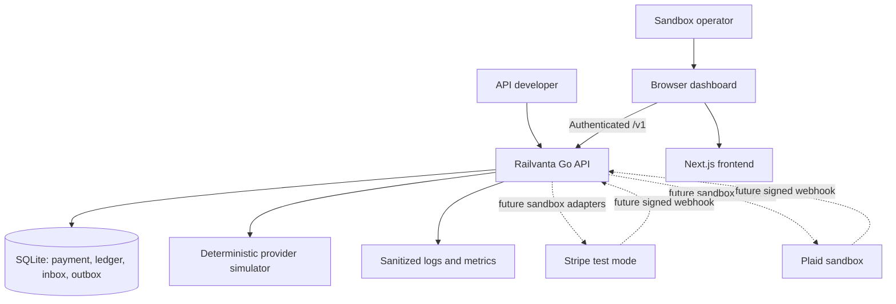
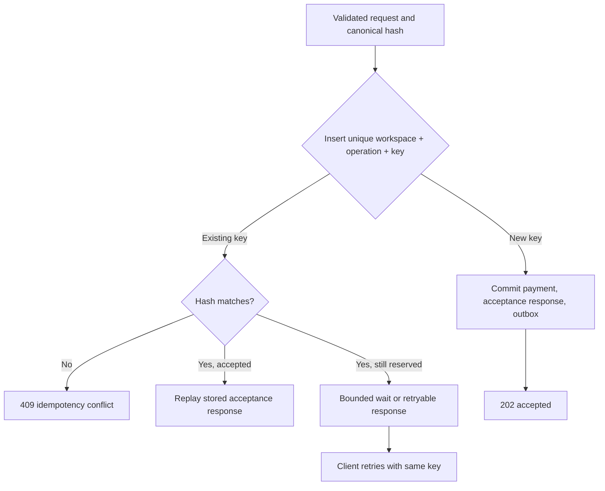
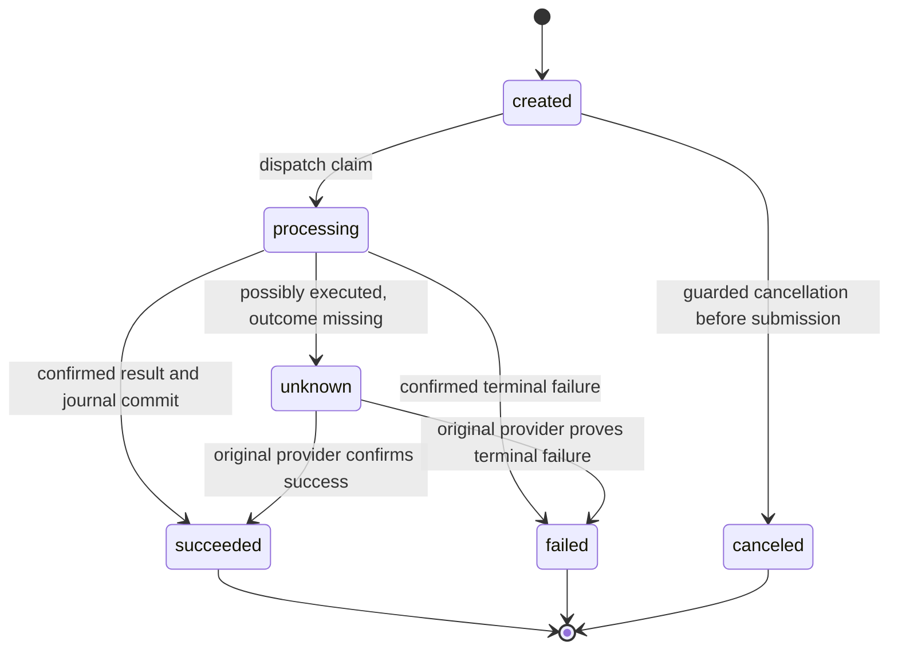
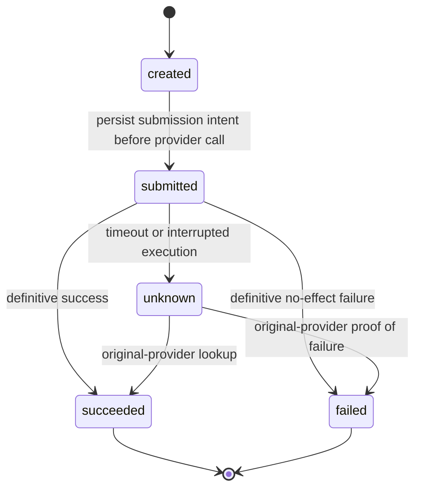
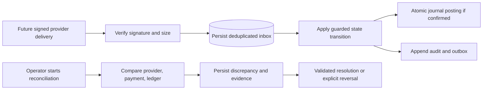

# System Flows

Runtime behavior of the Go API. This is the single home for the payment and attempt state machines. Module boundaries are in [architecture](../architecture.md), and durable records are in the [data model](data-model.md).

## System context



Solid arrows describe the first proposed implementation; dashed arrows describe deferred integrations. No real-money provider is in scope.

## Accept, dispatch, and record a payment

```mermaid
sequenceDiagram
    actor User
    participant Web as Next.js browser client
    participant API as Go API
    participant DB as SQLite
    participant Worker as In-process dispatcher
    participant Provider as Mock provider
    User->>Web: Submit sandbox payment
    Web->>API: POST /v1/payments + Idempotency-Key
    API->>API: Authenticate, authorize, validate, hash
    API->>DB: Begin short write transaction
    API->>DB: Reserve key + payment + audit + outbox + response
    DB-->>API: Commit
    API-->>Web: 202 accepted, payment ID, Location
    Worker->>DB: Claim event with lease; commit attempt and stable request key
    DB-->>Worker: Claim committed
    Worker->>Provider: Execute using stable provider key
    alt Confirmed success
        Provider-->>Worker: Success + provider reference
        Worker->>DB: Atomic guarded success + balanced journal + audit + outbox completion
    else Proven failure with no effect
        Provider-->>Worker: Definitive failure
        Worker->>DB: Record failed attempt and validated payment transition
    else Timeout or uncertain outcome
        Provider--xWorker: No trustworthy outcome
        Worker->>DB: Record unknown; schedule original-provider lookup
        Note over Worker,Provider: No automatic alternate-provider execution
    end
    Web->>API: GET /v1/payments/{id}
    API->>DB: Workspace-scoped read
    API-->>Web: Latest payment and attempt state
```

If the worker crashes after a provider call and before recording its result, recovery starts with the original attempt's durable provider key. A lease controls work ownership; it does not erase external side effects.

## Duplicate request handling



The acceptance transaction should make partially reserved records unobservable on its normal path. The retryable branch covers contention or a future explicit reservation protocol. Validation and authorization failures are not cached as accepted payments. Clients retain one key across transport retries and generate a new key only for a new logical payment.

### Implemented acceptance contract (WBS 2.1)

`payment.Service.Accept` (`backend/internal/payment/service.go`) runs one short transaction in this order: look up `(workspace_id, 'payment.create', key)`; if absent, check that the payment method belongs to the workspace and has at least one `payment_method_tokens` row; insert a `pending` idempotency record; insert the payment (`created`, version 1); insert the initial transition (`from_status` NULL → `created`); insert a `payment.dispatch` outbox row (deduplication key `payment.dispatch:{payment_id}`, payload `{"payment_id","workspace_id"}`); then complete the record with status `202` and the response body. The replay lookup runs before method validation, so a stored acceptance remains replayable.

| Situation | Response |
| --- | --- |
| New key, valid request | `202`, `Location: /v1/payments/{id}`, payment snapshot body |
| Same key, same canonical hash | Stored status and body replayed byte-for-byte, plus `Idempotent-Replayed: true` |
| Same key, different hash (amount, currency, method or merchant reference) | `409 idempotency_conflict`; the original is unchanged |
| Same key, record still `pending` (not observable on the normal path) | `409 idempotency_in_progress` with `Retry-After: 1` |
| Concurrent insert loses the unique race | Transaction rolls back and the loser re-reads the committed winner (bounded to three re-reads) |
| Method missing or in another workspace | `404 not_found`; nothing written |
| Method has no provider token | `422 payment_method_unusable`; nothing written |
| `SQLITE_BUSY` after `busy_timeout` | The whole transaction is retried up to four times with full-jitter exponential backoff (10–250 ms), then `503` with `Retry-After`; nothing committed |
| Missing or invalid header, body, amount or currency; auth or CSRF failure | `400`/`401`/`403`/`413`/`415` before the service runs; no idempotency record |

The canonical hash (`payment/idempotency.go`) covers operation, amount, currency, payment method and merchant reference, with length-prefixed fields; an absent merchant reference equals `""`. JSON field order and whitespace do not affect it. `GET /v1/payments/{id}` returns current state, so it can differ from the replayed acceptance snapshot once dispatch has moved the payment.

### Implemented dispatch contract (WBS 2.2, 2.3.5)

The in-process `event.Dispatcher` (`backend/internal/event/dispatcher.go`, `outbox.go`) claims due `outbox_events` rows of registered types only: `pending` with `available_at <= now`, or `processing` with an expired `lease_until`. Each claim is a compare-and-swap `UPDATE` that also matches the status and `lease_owner` it read, stores a fresh 32-byte `crypto/rand` token in `lease_owner`, sets `lease_until = now + DISPATCHER_LEASE` and increments `attempts`. While a handler runs, the lease is renewed every lease/3. `Renew`, `Complete`, `Release` and `Fail` all match `id`, `status = 'processing'` and the token; after another owner reclaims the row they return `event.ErrLeaseLost`. Handler errors release the row with full-jitter backoff; after 10 acquisitions it is parked as `failed`.

`payment.Executor` (`backend/internal/payment/dispatch.go`) handles `payment.dispatch`:

1. **Prepare (short transaction).** Read the payment. If `created`: route with `payment.Router` (the same code as `POST /v1/routing/evaluate`, inside the transaction), run `GuardNewAttempt`, read the method's token for the chosen provider, apply `created → processing` (version-guarded, audited), insert attempt *n* with the rule, reason and stable provider key `rv_{payment_id}_{n}`, and mark it `submitted` with `submitted_at`. Commit. If no provider is eligible: `created → processing → failed` with no attempt, and the command completes. If the payment is already `unknown`, terminal or canceled, the command completes with no effect.
2. **Provider call** with no transaction open and a `PROVIDER_TIMEOUT` deadline.
3. **Record (new transaction, busy-retried).** Every update is status-predicate guarded, and the dispatch row is completed in the same transaction (`event.Complete`); if the lease was lost, everything rolls back.

| Provider result | Attempt | Payment | Same transaction |
| --- | --- | --- | --- |
| `Succeeded` | `submitted\|unknown → succeeded`, provider reference, `completed_at` | `processing\|unknown → succeeded` (version-guarded, audited) | `ledger.PostPaymentSuccess` (debit `provider_clearing:{provider}`, credit `merchant_payable`, key `payment:{id}:success`) and outbox completion |
| `Declined` | `→ failed`, `error_code`, `completed_at` | `→ failed` | outbox completion |
| `Ambiguous` (timeout, outage, cancelled call) | `submitted → unknown`, `error_code`; `completed_at` stays NULL | `processing → unknown` | enqueue `payment.lookup` for the **same** attempt and provider, plus outbox completion |
| Dispatch reclaimed with the attempt still `submitted` (owner crashed or lost its lease) | `submitted → unknown`, `error_code = stale_submitted` | `processing → unknown` | enqueue `payment.lookup`; never resubmit, never another provider |

`ApplySuccess`, `ApplyDecline` and `ApplyUnknown` (`payment/outcome.go`) are exported for the recovery worker. Repeating a recorded outcome changes nothing (`Applied.Changed == false`). A conflicting late result returns `ErrLateOutcome` and writes nothing.

**`payment.lookup` command (consumed by WBS 2.4).** Payload `{"payment_id","workspace_id","attempt_id","provider_id","reason"}`; deduplication key `payment.lookup:{attempt_id}`, so there is one row per unresolved attempt. The handler reads `provider_idempotency_key` from the attempt row, calls `Lookup` on that provider outside any transaction, then calls `ApplySuccess` or `ApplyDecline` with its claim, or returns `event.RetryAfter(d, err)` to stay `unknown`. Until a handler is registered, these rows stay `pending`.

**Failover guard (2.2.11).** `GuardNewAttempt` rejects any new attempt while one is `created`, `submitted` or `unknown`. If the payment was ever `unknown`, it also rejects any provider other than the one already attempted. Ambiguous outcomes are resolved only at the original provider.

**Lifecycle (2.2.12).** `cmd/api` starts the dispatcher after migrations and demo seeding. On SIGTERM it stops claiming, waits up to `DISPATCHER_DRAIN_TIMEOUT` for in-flight handlers, then cancels them. A cancelled provider call is recorded as `unknown` on a context detached from shutdown. Only then is the database closed. Configuration: `DISPATCHER_POLL_INTERVAL` (250ms), `DISPATCHER_LEASE` (30s), `DISPATCHER_DRAIN_TIMEOUT` (5s), `DISPATCHER_MAX_IN_FLIGHT` (4), `PROVIDER_TIMEOUT` (10s), `MOCK_DELAYED_SUCCESS_DELAY` (2s), `MOCK_TIMEOUT_DELAY` (5s).

**Metrics (2.2.13), in process only.** `event.Metrics`: claims, reclaims, lease losses, parked rows, and a dispatcher lag histogram (claim time − `available_at`). `payment.ExecutionMetrics`: attempts started, outcomes by provider, the unknown-outcome count, stale reclaims, unroutable payments, blocked failovers, and an attempt latency histogram (`completed_at − submitted_at`). No exporter exists yet.

**Seeded scenario methods (demo mode).** `00000000-0000-7000-8000-00000000012{1..6}` select `success`, `decline`, `delayed_success`, `timeout_before_execution`, `timeout_after_success` and `outage`. Each workspace has one priority-0 `mock` rule per supported currency (`…0007{0,1}{1..5}`).

### Implemented recovery and cancellation contract (WBS 2.4)

**Lookup worker** (`payment/recovery.go`, registered on the dispatcher for `payment.lookup`). It reads the attempt and the provider code from the database, checks that the command names the attempt's own provider, and calls `Lookup` on that provider's adapter with the stored `provider_idempotency_key` and a `PROVIDER_TIMEOUT` deadline, with no transaction open. The answer maps as follows:

| Original provider says | Result |
| --- | --- |
| Found, `Succeeded` | One transaction: `ApplySuccess` (attempt and payment `unknown -> succeeded`, balanced journal, audit, command completion) |
| Found, `Declined` (recorded proof of no effect) | One transaction: `ApplyDecline` (`unknown -> failed`) |
| Found but still processing, `ErrUnavailable`, timeout, or no adapter | Stays `unknown`; the command is released with jittered exponential backoff (`RECOVERY_BASE_BACKOFF` 1s doubling to `RECOVERY_MAX_BACKOFF` 5m) and **no** `MaxAttempts` parking (`event.RetryAfterUnbounded`) |
| Not found, adapter declares `IdempotentReplay` | Same-provider replay: `Submit` with the same key and the method token for that provider. The provider returns the original charge or executes at most once; a definitive answer resolves as above, otherwise stay `unknown` |
| Not found, no replay contract | Stay `unknown`; nothing is sent. **Absence of a record is never treated as proof of no effect**, so `unknown -> failed` happens only on a recorded decline |

If the attempt was already resolved as `failed`, the worker asks once more only to catch a contradiction (the provider has a successful charge): that is recorded as a late outcome. It never replays for an attempt that is already failed. A worker that cannot reach the provider for such an attempt completes the command.

**Startup scan** (`Recovery.RecoverStale`, run by `cmd/api` after migrations and seeding, before the dispatcher starts). A `submitted` attempt whose `payment.dispatch` command has no live lease (not `processing` with `lease_until` in the future) is treated as possibly executed: attempt and payment move to `unknown` (`error_code = stale_submitted`, actor `system:recovery`) and a lookup at the attempt's own provider is scheduled (`RECOVERY_LOOKUP_DELAY`, default 0). A command whose lease is still live is left alone; the dispatcher's reclaim path handles it when the lease expires. Nothing is resubmitted and no attempt is created by either path.

**Cancellation** (`POST /v1/payments/{id}/cancel`, operator role). `Service.Cancel` runs one transaction: `created -> canceled` as a compare-and-swap on `(status, version)`, the audit transition, and `event.SkipPending` which marks a still-pending `payment.dispatch` command delivered. The dispatcher's prepare step performs the same `(created, version)` compare-and-swap for `created -> processing`, so exactly one of them wins. If dispatch had already claimed the command, the dispatcher re-reads the payment after a stale-version loss and completes the command with no attempt when it finds `canceled`. Responses: `200` with the canceled payment (also when it already was canceled), `409 not_cancelable` for `processing`, `unknown`, `succeeded` or `failed`, `404` for another workspace's payment, `403` for a reader. Cancellation never contacts a provider and never posts a journal.

**Terminal states never regress.** Three layers: `ValidateTransition` has no edge out of a terminal state; every update compares status and version; the `payments_terminal_status` trigger aborts a status change from `succeeded`, `failed` or `canceled`. `ApplySuccess`/`ApplyDecline`/`ApplyUnknown` return `ErrLateOutcome` for a result that conflicts with the recorded state.

**Late results.** A provider result that conflicts with a terminal state (a success after `failed`, a decline after `succeeded`) is not applied. Both the dispatch path and the lookup path write one `payment.late_outcome` row in `outbox_events` (deduplication key `payment.late_outcome:{attempt_id}:{outcome}`; payload `payment.LateOutcome`: payment, attempt, provider, outcome, provider reference, code, the recorded payment and attempt statuses, source `dispatch|lookup`, observation time) in the same transaction that completes the command. No handler is registered for the type, so the row stays `pending`: durable and visible to the future reconciliation consumer (WBS 4.2), which owns turning it into a discrepancy. `GET /v1/payments/{id}/recovery` lists these rows for the payment. A late success is never auto-reversed or reposted.

**`GET /v1/payments/{id}/recovery`** returns `lookup_status` (`none|pending|in_progress|resolved|failed`), `lookup_attempts`, `next_lookup_at`, `last_lookup_error`, `retry_allowed` (always `false`) and `late_outcomes`. It never exposes a provider key. No endpoint can retry, resubmit or re-dispatch a payment.

**Metrics (2.4.9), in process only.** `payment.RecoveryMetrics`: lookups, lookups the provider could not answer, same-key replays, rounds that left the payment unknown, stale attempts recovered at startup, resolutions by result (`succeeded`, `declined`, `late_outcome`, `already_resolved`), and a histogram of how long a payment stayed unknown before resolution (latest transition into `unknown` to resolution). `Recovery.Snapshot(ctx)` adds database gauges: the number of unknown payments and the oldest unresolved payment ID and age. No exporter exists yet.

**Crash-injection harness** (`backend/tests/crash_harness_test.go`). A crash is a test hook that aborts a handler with nothing further recorded, the same durable state a SIGKILL leaves: `AfterPrepare` (submitted attempt, no charge), `BeforeRecord` (provider executed, result unrecorded) and `BeforeResolve` (lookup answered, resolving transaction never ran). The "restart" builds fresh executor, recovery and dispatcher over the same file-backed WAL database with the clock past every lease, runs the startup scan, and settles. Every point must end with one attempt under the original key, at most one charge, one journal and `ledger.Check` clean.

**Limits.**
- Lookup depends on the provider's by-key lookup. A provider with neither lookup nor replay leaves payments `unknown` indefinitely; only an operator-driven reconciliation (WBS 4.2) can then decide.
- An unknown payment is never auto-failed on silence. It can wait unboundedly, so watch `Unresolved` and the oldest-unresolved age.
- Late outcomes are recorded, not resolved: a provider success against a failed payment needs reconciliation and an explicit reversal or correction, not an automatic one.
- The startup scan cannot tell a hung owner on a live lease from a healthy one; it waits for the lease to expire, so recovery after a crash takes up to `DISPATCHER_LEASE`.
- Delayed-success mock charges settle on their first lookup or replay, so the mock cannot model a provider that stays "processing" across many lookups.
- Metrics reset on restart.

## Payment state machine



Cancellation uses a conditional update against state/version and races with dispatch safely: only one wins (see "Implemented recovery and cancellation contract"). The initial MVP rejects cancellation once processing starts. Unknown outcomes stay unknown until evidence supports a terminal transition; an operator cannot clear the flag merely to retry. Refunds and reversals are separate future operations and do not rewrite a succeeded payment into a failed one.

## Attempt state machine



A stale `submitted` attempt discovered after restart is treated as potentially executed. It follows the uncertainty recovery path before another submission is considered. Today the dispatcher does this when it reclaims an expired `payment.dispatch` lease: the attempt and payment become `unknown` and a `payment.lookup` is scheduled. The startup scan and lookup worker (WBS 2.4) build on this; see below.

## Webhooks and reconciliation



Acknowledge a valid webhook after durable inbox acceptance. Duplicate deliveries receive a successful acknowledgement without duplicate financial posting. A reconciliation run may use deterministic mock evidence in the MVP; label it simulated. It must not manufacture journals to make mismatches disappear. External webhook signature and provider lookup behavior will be specified against official provider contracts when integrations begin.

### Implemented reconciliation contract (WBS 4.2)

`POST /v1/reconciliation/runs` (operator only, `Idempotency-Key` is the run key, body is a `window_start`/`window_end` pair of at most 366 days) runs one synchronous, read-only comparison in a single write transaction. It considers settled payments created in the window that have a mock-provider attempt (`created` and `processing` payments are in flight and skipped) and compares each with the mock charge recorded for the latest attempt's idempotency key and with the posted, non-reversal success journal. The same key and window returns the stored run (200) and adds only discrepancies whose `(run_id, fingerprint)` is new; the same key with another window is 409.

| Kind | Raised when |
| --- | --- |
| `unknown_outcome` | The payment is still `unknown` (the evidence says whether the mock holds a charge). |
| `missing_at_provider` | The payment succeeded but the mock has no charge. |
| `status_mismatch` | The charge status does not support the payment status (`succeeded` ↔ `succeeded`, `declined` ↔ `failed`), or a success journal exists for a payment that did not succeed. |
| `amount_mismatch` | The charge amount or currency differs from the payment, or the journal totals differ from the amount. |
| `missing_posting` | The payment succeeded and has no posted success journal. |

The run never writes a payment, attempt, journal or charge and never calls a provider. Pending `payment.late_outcome` rows for the compared payments are attached to the discrepancy as evidence and marked `delivered` (`last_error` names the run); the payment is not changed. Counts: `matched` is compared payments with no discrepancy, `unmatched` is the three missing/unknown kinds, `mismatch` is the two mismatch kinds. Evidence is stored as JSON in `details`, labelled `simulated`.

`POST /v1/reconciliation/discrepancies/{id}/resolve` (operator only) records a status change (`open`, `investigating`, `resolved`) with a required note. Each change appends a row to `reconciliation_resolution_events`; resolving also stores `resolution_note`, `resolved_by` and `resolved_at`. Triggers in migration 0004 make evidence and history immutable, reject a blank note, and make `resolved` final. Resolution is evidence only: the payment and ledger are never changed, so an unknown payment stays `unknown` and a missing posting stays missing until a separately designed correction exists.

## Failure recovery checklist

| Failure point | Durable evidence | Required recovery |
| --- | --- | --- |
| Before acceptance commit | No accepted payment | Retry original key |
| After commit, before HTTP response | Stored response and payment | Replay acceptance |
| After claim, before known execution | Attempt and request key | Resolve original attempt before replay |
| Provider timeout | Unknown or stale submitted attempt | Query original provider; block fallback |
| Before success transaction commits | Attempt plus provider reference/key | Confirm outcome and atomically post once |
| Duplicate webhook/event | Unique inbox/event business key | Acknowledge or consume without another posting |
| Database busy | Transaction rolled back or result unresolved | Bounded database retry; never blindly repeat provider call |
