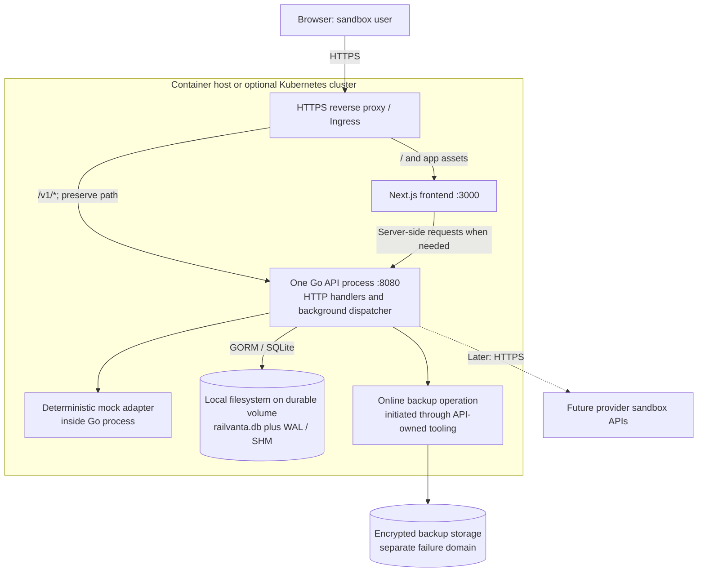

# Deployment

Deployment targets, configuration, startup, health and backup/restore for the sandbox. Cluster resources for the optional Kubernetes stage are in [kubernetes](kubernetes.md).

## Required Docker Compose runtime

The repository now includes [docker-compose.yml](../../docker-compose.yml), separate [API](../../infrastructure/docker/api.Dockerfile) and [frontend](../../infrastructure/docker/web.Dockerfile) image definitions, and an unprivileged Nginx proxy. This is the required local container workflow, introduced alongside the M1 scaffold; the full recovery/release gates remain in WBS 5.2.

Use `pnpm compose:config`, then `pnpm compose:up` after the dependency lockfiles are ready. The public origin is `http://localhost:3000` (overridable with `RAILVANTA_PORT`). Only the proxy binds host loopback; it routes `/v1` to `api:8080` and other paths to `web:3000`. API health remains at container loopback `127.0.0.1:8081`. The API alone mounts the named SQLite volume; `pnpm compose:down` retains it.

Both application images run non-root with read-only roots and explicit writable mounts. Images are built from source; neither build nor runtime is claimed verified yet. Compose configuration validation passes, but Docker socket access and unresolved M1 dependency files currently block full validation. Container demo mode is off; loopback-only fixture bootstrapping must not be enabled on the container's wildcard API bind.

The frontend enables Next.js standalone output with the monorepo tracing root and explicitly copies static/public assets, as required by [Next.js output documentation](https://nextjs.org/docs/app/api-reference/config/next-config-js/output). Its upstream address is a build argument because rewrites are recorded during build. Compose waits for image health checks through `service_healthy`; see [Docker startup ordering](https://docs.docker.com/compose/how-tos/startup-order/).

## Deployment stages

| Stage | Compute | Persistence | Purpose |
| --- | --- | --- | --- |
| Local development | Next.js development process and one Go API process | Local SQLite file | Native editing/debugging alternative; payment execution remains later work |
| Container sandbox | Separate frontend and API containers on one host | Durable local filesystem volume owned by API | Required local image/Compose runtime; recovery and restore verification pending |
| Optional Kubernetes sandbox | Frontend Deployment and one API StatefulSet pod | One persistent volume mounted by API | Learn scheduling, TLS, resource controls, and operational recovery |
| Future scale design | Stateless frontend and multiple API/worker processes | PostgreSQL after a separate migration project | Only after correctness, concurrency, and operational gates pass |

The API process owns database access and runs the durable background dispatcher. Do not deploy a separate worker against the SQLite volume. Kafka, Redis, and Temporal are not required for this MVP. Start with the deterministic mock provider; Stripe test mode and Plaid Sandbox are later integrations.

## Deployment diagram

Use a single public origin. Preserve `/v1` when forwarding API requests; send other paths to Next.js. Server-side frontend requests use an internal API origin. Keep health endpoints private. A Kubernetes Ingress requires a compatible controller; the Ingress object alone is insufficient. [Kubernetes Ingress documentation](https://kubernetes.io/docs/concepts/services-networking/ingress/)

## Configuration contract

The M1 API config loader implements `APP_ENV`, `HTTP_ADDR`, `HEALTH_ADDR`, `SQLITE_PATH`, `PUBLIC_APP_ORIGIN`, and loopback-only `DEMO_MODE`. Next.js implements `API_INTERNAL_ORIGIN`. Container values and external provider credentials below remain deployment design; full runtime verification is pending.

| Key | Consumer | Intended value or rule |
| --- | --- | --- |
| `APP_ENV` | API | `sandbox`; reject live operation configuration |
| `HTTP_ADDR` | API | `:8080` by default; literal loopback required for demo mode |
| `HEALTH_ADDR` | API | `127.0.0.1:8081` by default; literal loopback only |
| `SQLITE_PATH` | API | `/var/lib/railvanta/railvanta.db` in containers |
| `API_INTERNAL_ORIGIN` | Next.js server | Internal API service URL; never a provider credential |
| `PUBLIC_APP_ORIGIN` | Server configuration | Deployed HTTPS origin for origin/redirect validation |
| Session and provider credentials | API only | Inject through secret management; no real-money credentials |

Public JavaScript uses relative `/v1` URLs. Never put provider secrets or session signing keys into `NEXT_PUBLIC_*` variables. Keep environment examples limited to placeholders. Database files, backup archives, and logs must not contain raw card or bank credentials.

## SQLite storage boundary

Mount the entire database directory, including its WAL and shared-memory files. Use a filesystem with reliable locking and durable writes, backed by local disk or a block device mounted on one node. Do not use NFS/RWX shared filesystem storage: SQLite WAL relies on same-host coordination. Plan capacity for the database, WAL growth, temporary files, and backups. [SQLite WAL documentation](https://www.sqlite.org/wal.html)

One API replica is an operational restriction, not a high-availability guarantee. A lost node or volume makes the API unavailable. A single-node local volume also constrains rescheduling; a reattachable block volume still depends on the storage provider's attachment and fencing behavior. Move to PostgreSQL before introducing independently scaled writers or separate workers.

## Startup and schema changes

1. Validate sandbox-only settings and secret availability before accepting traffic.
2. Mount the data directory with the API user/group able to create the database and sidecar files.
3. Confirm no previous API process or migration process can access the volume as an active owner.
4. Apply explicit, versioned migrations in the API startup sequence before starting HTTP readiness or the dispatcher. Initial database creation follows the same path.
5. Validate the schema version and required SQLite connection settings; see [persistence](../backend/persistence.md).
6. Start the dispatcher, HTTP handlers, and readiness reporting. A failed migration leaves the API unready.

For incompatible migrations, enter a maintenance window: disable writes, drain requests and dispatcher work, stop the owner, take a verified backup, migrate once, then start the compatible API image. Do not run a migration Job concurrently against the live SQLite owner. Image rollback is safe only when schema compatibility is proven; otherwise use a tested forward fix or controlled restore with explicit data-loss accounting.

## Health, release, and recovery checks

Proposed API probes are `/health/startup`, `/health/live`, and `/health/ready`. Startup becomes successful after initialization. Liveness checks process responsiveness without calling providers. Readiness checks initialization, compatible schema, database access, and whether the process is draining. A provider outage should surface as degraded service metrics rather than restart loops. Kubernetes distinguishes these probe roles and delays other probes while a startup probe is failing. [Probe documentation](https://kubernetes.io/docs/tasks/configure-pod-container/configure-liveness-readiness-startup-probes/)

On termination, first become unready and stop new dispatch claims, then finish or safely abandon bounded in-flight work, persist recoverable status, close the database, and exit. An interrupted provider call remains ambiguous until resolved through provider lookup or reconciliation; deployment must not turn that outcome into a cross-provider retry.

Before releasing a sandbox image, verify:

- Formatting, build, domain tests, API contract tests, and frontend tests pass in CI.
- A duplicate payment request creates one logical payment; workspace isolation holds.
- Restarting after dispatch recovers durable work without duplicate ledger posting.
- A restored backup passes SQLite integrity and application invariant checks.
- The frontend displays unavailable/error states when the API is offline and labels demo metrics.

## Backups and restoration

Use SQLite's online backup API through API-owned tooling to produce a consistent snapshot, then upload the completed archive to encrypted storage outside the volume's failure domain. Do not copy only an actively used `.db` file or let an independently scheduled pod open the live WAL database on another node. SQLite provides its backup API specifically for consistent online snapshots. [SQLite backup documentation](https://www.sqlite.org/backup.html)

Record snapshot time, schema version, checksum, and application release. Set backup frequency and retention from an agreed recovery point objective; no recovery target has been measured yet. Monitor backup age and available disk space.

To restore: stop and fence the old owner; preserve the current volume for investigation; restore into a clean directory; validate checksum, `PRAGMA integrity_check`, and `PRAGMA foreign_key_check`; run ledger and payment-state checks; start a matching release; then reconcile events occurring after the snapshot before resuming affected payments. Test this sequence on a separate volume. Never replace files underneath a live API process.

## Implemented container backup, restore and drill (WBS 5.2)

The Compose stack implements the procedure above with these pieces (all verified locally; see the drill record below).

**Health.** The API serves `/health/startup`, `/health/live` and `/health/ready` on the container-loopback `HEALTH_ADDR` (`127.0.0.1:8081`) only. The proxy answers 404 for `/health/*`, no health port is published, and the Compose/Dockerfile healthchecks use `wget` against the loopback listener. On SIGTERM the API reports unready, stops dispatcher claims, drains bounded in-flight work, shuts the HTTP servers and closes SQLite; `docker compose stop api` exits 0.

**Backup.** `railvanta-api backup --db <path> --out-dir <dir>` opens the database read-only and runs `VACUUM INTO` (one read transaction, consistent while the API writes), verifies the snapshot (`integrity_check`, `foreign_key_check`), fsyncs and renames it, and writes `<snapshot>.json` with `snapshot_at`, `schema_version`, `sha256`, `size_bytes` and `release` (`RAILVANTA_RELEASE`, `RAILVANTA_GIT_SHA`, set through image build args). `scripts/backup-db.sh [host-dir]` runs it inside the API container, copies snapshot and manifest to the host, re-verifies the checksum and removes the in-volume copy. Nothing copies the live `.db`, `-wal` or `-shm` files. Ship the host copies to encrypted storage outside the volume's failure domain; no retention or RPO is defined yet.

**Domain check.** `railvanta-api check [--db <path>]` (read-only, one read transaction) runs `PRAGMA integrity_check`, `PRAGMA foreign_key_check`, `ledger.Verify` (every posted journal balances; each succeeded payment has exactly one matching success journal; failed/canceled payments have none; reversals mirror their original) and structural checks (no attempt without a payment, no unresolved attempt on a terminal payment, no entry or journal without its parent, no succeeded payment without a succeeded attempt). It exits non-zero and lists every violation.

**Restore.** `scripts/restore-backup.sh <backup.db> [--start]`: (1) fence: `docker compose stop` stops every service; (2) the current data volume is preserved and never modified; (3) a new volume `<old>-restored-<UTC time>` is created and `railvanta-api restore` (from the image that matches `RAILVANTA_API_IMAGE`) verifies the manifest SHA-256, refuses a snapshot whose schema is newer than the binary, refuses a non-empty target, copies the snapshot and runs the full check, removing the restored file on any failure (the script then removes the new volume and leaves the stack stopped); (4) with `--start` the stack starts on the new volume (`RAILVANTA_DATA_VOLUME=<new>`, which `docker-compose.yml` honors) and the check is re-run against the live database. Keep exporting `RAILVANTA_DATA_VOLUME` (or put it in an untracked `.env`) so later `docker compose up` calls use the restored volume. Roll back by setting it to the preserved volume. After a restore, reconcile events that happened after the snapshot time before resuming affected payments; startup recovery re-drives in-flight attempts from the snapshot.

**Drill under write load.** `scripts/restore-drill.sh [seconds] [workers]` seeds credentials into a fresh sandbox stack, creates payments from parallel workers, takes a backup two seconds in, restores into a new volume, starts on it and re-runs the check after in-flight work settles.

| Date (UTC) | Release | Result |
| --- | --- | --- |
| 2026-11-01 | `m5-wip` (local build, WBS 5.2 branch) | 8 workers, 20 s; backup at t+2 s caught 600 payments but only 207 journals and 211 attempts (a genuinely mid-flight snapshot). Live DB after load: 600/600/600, `checks=ok`. Restore: manifest checksum, `integrity_check`, `foreign_key_check` and domain checks passed (`checks=ok`); old volume preserved. After start the restored stack's recovery completed the in-flight work: 600 payments, 600 journals, 600 attempts, `checks=ok`. |

The container E2E suite also covers backup, stop, restore into a clean volume and start (payments, journals, attempts and an idempotency replay recorded before the backup survive; a payment created after it does not), a tampered-manifest refusal, and a SIGKILL of the API container while a delayed-success attempt is submitted (one provider charge, one journal, `check` passes).

**Supply chain.** Dockerfile `FROM` lines and the proxy image are pinned by digest (`scripts/check-image-pins.sh` enforces it). Digests resolved with `docker buildx imagetools inspect` on 2026-10-31: `golang:1.26-alpine@sha256:a2012b4a...`, `alpine:3.23@sha256:ff7f0c72...`, `node:22-bookworm-slim@sha256:4b150b48...`, `nginxinc/nginx-unprivileged:stable-alpine@sha256:f5116ed4...`; the harness helper `python:3.13-alpine@sha256:7984cf56...` and `gitleaks v8.28.0@sha256:cdbb7c95...` are pinned the same way. Bump them deliberately (re-resolve, rebuild, rerun the suite). The `# syntax=docker/dockerfile:1` frontend and the pnpm install inside the web image are not digest-pinned. `.github/workflows/containers.yml` builds the images, records their image IDs in the job summary, scans history, working tree and image filesystems with `scripts/secret-scan.sh`, and runs `E2E_BASE_URL=http://localhost:3000 pnpm test:e2e` against the stack; it has not run on GitHub yet.

**Sandbox credentials in containers.** `DEMO_MODE` stays off in containers (its trust boundary is a loopback API bind). `railvanta-api seed-demo` provisions the demo workspace and the `DEMO_*` credentials passed in its environment; it is how the container E2E harness authenticates and needs a sandbox database (it refuses different credentials in an already seeded one; the harness caches its generated credentials per Compose project in the OS temp directory).
