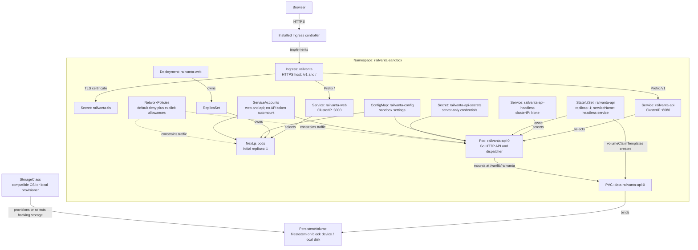

# Kubernetes (optional)

Optional M6 sandbox deployment, after local and container delivery pass. Migration, probe and restore procedures are in [deployment](deployment.md).

## Resource relationship diagram

Solid arrows describe traffic, selection, or configuration. Labeled arrows distinguish workload ownership from storage binding; the diagram does not imply that every relationship is a Kubernetes owner reference.

## Resource catalog

| Resource | Proposed specification | Reason |
| --- | --- | --- |
| Namespace | `railvanta-sandbox` | Scope sandbox resources and quotas |
| Ingress | HTTPS; `/v1` Prefix to API; `/` Prefix to frontend; no path stripping | Keep browser API traffic on the app origin |
| TLS Secret | Certificate for the selected sandbox hostname | TLS termination at the controller |
| Frontend Deployment | `railvanta-web`; initially one pod; port `3000` | Independently replaceable Next.js runtime |
| API StatefulSet | `railvanta-api`; exactly one pod; port `8080` | Stable pod identity and persistent claim association |
| Services | Frontend and API ClusterIP; API headless governing service | Internal routing and StatefulSet network identity |
| PVC | `data-railvanta-api-0`; filesystem volume; initial sizing after measurement | Persist SQLite database and sidecar files |
| ConfigMap | Sandbox mode, API path/port, internal API origin | Nonsecret runtime configuration |
| API Secret | Session material; later provider sandbox credentials | Prevent secrets entering frontend bundles |
| ServiceAccounts | Separate API and web accounts; token automount disabled | Workloads require no Kubernetes API access |
| NetworkPolicies | Deny by default, then permit listed flows | Bound ingress and egress using an enforcing CNI |
| ResourceQuota / LimitRange | Budget-approved namespace ceilings and defaults | Prevent accidental sandbox resource sprawl |

Choose a CSI driver supporting `ReadWriteOncePod` when available and validated; otherwise enforce exclusive ownership operationally with `ReadWriteOnce` and storage fencing. `ReadWriteOnce` is a node-level access mode, not a one-pod lock. A PVC alone does not enforce the application's single-owner rule. Retain the volume across workload deletion and require explicit data-retention decisions. [Persistent volume access modes](https://kubernetes.io/docs/concepts/storage/persistent-volumes/#access-modes)

StatefulSets associate stable identities with storage but do not make this single-replica service highly available. Keep the API replica count fixed at one and do not attach an API HPA. The frontend may scale after its session and caching behavior is tested. [StatefulSet documentation](https://kubernetes.io/docs/concepts/workloads/controllers/statefulset/)

## Storage and scheduling

- Mount the whole `/var/lib/railvanta` directory. The SQLite owner needs write access for `railvanta.db`, `railvanta.db-wal`, and `railvanta.db-shm`.
- Use a block device mounted as a local filesystem or a true local volume. Do not use a multi-node shared filesystem for WAL. [SQLite WAL constraints](https://www.sqlite.org/wal.html)
- For node-local storage, use topology-aware scheduling and accept node-loss downtime. For reattachable volumes, validate attachment exclusivity and the storage provider's fencing procedure.
- Set storage reclaim and claim-retention behavior deliberately. Namespace deletion is not a backup plan.
- Do not create a separate worker Deployment, migration Job, backup CronJob, or sidecar that independently writes the live database. The API process runs the dispatcher and exposes an authenticated internal backup operation once implemented.

## Pod configuration

Use dedicated nonroot numeric users in both images. Set `runAsNonRoot: true`, `allowPrivilegeEscalation: false`, dropped capabilities, and `seccompProfile: RuntimeDefault`. Use a read-only root filesystem, with explicit writable mounts for API data and any required Next.js runtime cache or temporary files. Set API `fsGroup` consistently with the image's group and test permission behavior with the chosen CSI driver. [Kubernetes security context documentation](https://kubernetes.io/docs/tasks/configure-pod-container/security-context/)

CPU/memory requests and limits remain to be measured; record initial values when manifests are implemented and refine them using load tests. Bound graceful termination to the API's request/provider timeout policy. Add startup, liveness, and readiness probes with the semantics in [deployment](deployment.md), rather than using an external provider as a liveness dependency.

## Network and secret boundaries

Allow these flows explicitly:

1. Ingress controller to frontend port `3000` and API port `8080`.
2. Frontend server to API port `8080` for server-side requests.
3. Workloads to cluster DNS; API to approved sandbox provider and backup endpoints when those features exist.
4. Monitoring components to private telemetry endpoints when monitoring is configured.

Basic NetworkPolicy does not express arbitrary HTTPS hostname allowlists; use a suitable egress gateway or CNI capability when domain restrictions are required. Keep probes and internal administrative endpoints out of public Ingress routing. Route only `/v1` publicly to the API; enforce authentication, workspace authorization, and request limits in the API independently of network policy. [NetworkPolicy capabilities](https://kubernetes.io/docs/concepts/services-networking/network-policies/)

Inject only server-required secrets into the API, grant operators narrowly scoped access, and redact logs. TLS Secret, application Secret, and ConfigMap are separate resources with separate purposes. Backups inherit the sensitivity of their source data.

## Lifecycle and failure handling

For initial startup, the sole API container applies versioned migrations before becoming ready or starting dispatch. A failed migration must fail startup without deleting the PVC. Use an explicit maintenance window for incompatible changes; never run concurrent migration processes against this SQLite database.

For ordinary replacement, become unready, stop claims, drain bounded work, close the database, and wait for the old process to exit before the replacement opens the volume. Do not force-delete a partitioned API pod and assume it has stopped. If the node cannot be contacted, fence the old node or volume owner using infrastructure controls before authorizing replacement. Record unresolved provider attempts for reconciliation. See [StatefulSet pod deletion safety](https://kubernetes.io/docs/tasks/run-application/force-delete-stateful-set-pod/).

A PodDisruptionBudget is not a second replica or storage failover mechanism. If one is later configured to block voluntary eviction, provide a maintenance procedure that deliberately permits downtime; otherwise node drains can remain blocked. For this sandbox, schedule API maintenance with an acknowledged outage rather than claiming zero-downtime rollout.

Before treating manifests as usable, validate service selectors, PVC binding, permissions, image digests, probe behavior, TLS routing, termination, and backup restoration on a test cluster. The diagram is a design reference and is not a `kubectl apply` artifact.
