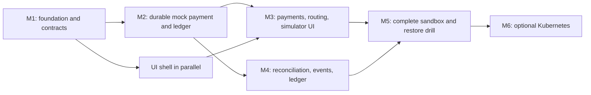

# Roadmap

Deliverable hierarchy, milestones and deferred scope. Dependencies are completion gates, not calendar estimates.

**Current status:** source for M1 work packages 1.1–1.4 is added. Full dependency-backed verification, generated contracts, merge gates, and CI remain pending. The [WBS](wbs.md) records these packages as in progress. Reach a verified M1 before moving to M2, the durable mock payment and ledger.

## Deliverable hierarchy

```mermaid
flowchart TB
    Project[Railvanta sandbox] --> Foundation[1. Foundation and contracts]
    Project --> Core[2. Payment correctness]
    Project --> Frontend[3. Next.js operations UI]
    Project --> Operations[4. Ledger and reconciliation]
    Project --> Delivery[5. Verification and delivery]
    Foundation --> Layout[Go and Next.js scaffolding]
    Foundation --> Persistence[SQLite migrations and GORM]
    Foundation --> Auth[Workspace auth and API contract]
    Core --> Accept[Idempotent acceptance]
    Core --> Execute[Mock provider and durable dispatch]
    Core --> Recovery[Uncertain outcomes and recovery]
    Frontend --> Shell[Landing, shell, responsive navigation]
    Frontend --> Payments[Overview, payments, detail]
    Frontend --> Controls[Routing, provider health, simulator]
    Operations --> Ledger[Balanced immutable ledger]
    Operations --> Reconcile[Comparison runs and discrepancies]
    Operations --> Events[Inbox, audit, event explorer]
    Delivery --> Tests[Concurrency, failure, browser tests]
    Delivery --> Images[Containers, CI, restore drills]
    Delivery --> Cluster[Optional Kubernetes sandbox]
```

## Work packages

The tasks and acceptance gates for each work package (1.1–5.4), plus their status, are tracked as a checklist in the [WBS](wbs.md).

## Milestones and critical dependencies

M2 is the first correctness milestone: a payment survives response loss and process restart, produces one balanced posting, and exposes ambiguous outcomes safely. Complete it before external provider integration. Frontend shell work may proceed concurrently against explicitly labeled fixtures, but API-backed feature acceptance requires the real mock payment flow.

## Verification matrix

The required scenarios (idempotency, dispatch, accounting, isolation, UI and operations) and the evidence each needs are a checklist in the [WBS verification matrix](wbs.md#verification-matrix).

Use a temporary on-disk SQLite database for integration/concurrency tests so file locking and WAL behavior are exercised. Keep deterministic simulator results reproducible. Coverage percentages and performance targets must be agreed and measured during implementation; none are claimed today.

## Deferred backlog

Stripe test mode and Plaid sandbox require provider-specific contracts, webhook security, and reconciliation evidence. Capture, partial refunds, bank settlement/returns, PostgreSQL migration, independent workers, and production fund movement require additional state models and approval of their own scope. Do not place these behind working-looking controls before the underlying capability exists.

Record completed work packages and their actual verification results in the [WBS](wbs.md) as they land.
