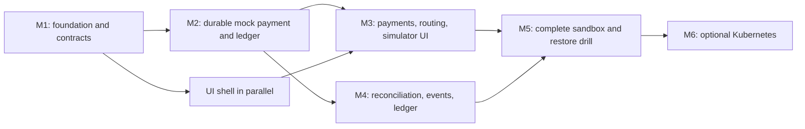

# Roadmap

Deliverable hierarchy, milestones and deferred scope. Dependencies are completion gates, not calendar estimates.

**Current status:** M1–M5 source is integrated on `feat/m5-m6-verification-delivery` and verified locally (see [Recorded results](#recorded-results)); the optional Kubernetes work (M6) is partly verified. GitHub Actions has not run, so every CI gate is open. Release documentation (5.4) is in progress: measurements, limitations and the case study are written; the [WBS](wbs.md) has the exact state of each box.

## Deliverable hierarchy

```mermaid
flowchart TB
    Project[Railvanta sandbox] --> Foundation[1. Foundation and contracts]
    Project --> Core[2. Payment correctness]
    Project --> Frontend[3. Next.js operations UI]
    Project --> Operations[4. Ledger and reconciliation]
    Project --> Delivery[5. Verification and delivery]
    Foundation --> Layout[Go and Next.js scaffolding]
    Foundation --> Persistence[SQLite migrations and GORM]
    Foundation --> Auth[Workspace auth and API contract]
    Core --> Accept[Idempotent acceptance]
    Core --> Execute[Mock provider and durable dispatch]
    Core --> Recovery[Uncertain outcomes and recovery]
    Frontend --> Shell[Landing, shell, responsive navigation]
    Frontend --> Payments[Overview, payments, detail]
    Frontend --> Controls[Routing, provider health, simulator]
    Operations --> Ledger[Balanced immutable ledger]
    Operations --> Reconcile[Comparison runs and discrepancies]
    Operations --> Events[Inbox, audit, event explorer]
    Delivery --> Tests[Concurrency, failure, browser tests]
    Delivery --> Images[Containers, CI, restore drills]
    Delivery --> Cluster[Optional Kubernetes sandbox]
```

## Work packages

The tasks and acceptance gates for each work package (1.1–5.4), plus their status, are tracked as a checklist in the [WBS](wbs.md).

## Milestones and critical dependencies

M2 is the first correctness milestone: a payment survives response loss and process restart, produces one balanced posting, and exposes ambiguous outcomes safely. Complete it before external provider integration. Frontend shell work may proceed concurrently against explicitly labeled fixtures, but API-backed feature acceptance requires the real mock payment flow.

## Verification matrix

The required scenarios (idempotency, dispatch, accounting, isolation, UI and operations) and the evidence each needs are a checklist in the [WBS verification matrix](wbs.md#verification-matrix).

Use a temporary on-disk SQLite database for integration/concurrency tests so file locking and WAL behavior are exercised. Keep deterministic simulator results reproducible. Coverage percentages and performance targets must be agreed and measured during implementation; none are claimed today.

## Deferred backlog

Stripe test mode and Plaid sandbox require provider-specific contracts, webhook security, and reconciliation evidence. Capture, partial refunds, bank settlement/returns, PostgreSQL migration, independent workers, and production fund movement require additional state models and approval of their own scope. Do not place these behind working-looking controls before the underlying capability exists.

Record completed work packages and their actual verification results in the [WBS](wbs.md) as they land.

## Recorded results

Only actual runs are recorded here. Nothing below is a projection.

### Local (WBS 5.4.5 measurements on the integrated M1-M5 tree)

- Date: 2026-11-01 UTC. Commit: `5b33a29` (`feat/m5-m6-verification-delivery`). Environment: Apple M4 Pro, macOS 26.4 (Darwin 25.4), arm64, Go 1.26.2, Node v22.18.0, pnpm 11.3.0; native processes, temporary SQLite, mock provider. Full methodology, caveats and tables: [measurements.md](measurements.md).

| Measurement | Result |
| --- | --- |
| `go -C backend test -race -count=1 ./... -v` | exit 0; 12 packages ok; 260 PASS lines (134 top-level), 0 FAIL, 0 SKIP |
| `pnpm test:web` | 8 files, 95 tests passed |
| `CI=1 pnpm run test:e2e:ci` | 88 passed, 5 skipped (container-only `ops` specs), 0 failed (3.3 min) |
| Case-study spec files, run together | 51 passed, 0 failed; central demo alone 1 passed; `node scripts/measure-central-demo.mjs` PASS |
| `node scripts/measure-latency.mjs 200` acceptance (1 / 8 / 32 clients) | p50 1.3 / 3.9 / 11.7 ms, p95 2.5 (sequential) / 10.5 / 30.7 ms, p99 2.9 (sequential) / 13.5 / 38.1 ms |
| Time to `succeeded` (server-side), idle / burst of 200 at 32 clients | p50 1 ms / 1148 ms, p95 2 ms / 2257 ms |
| Same idempotency key at 2 / 8 / 32 concurrent requests (5 rounds each) | 1 payment, 1 charge, 1 journal every round |
| `node scripts/measure-recovery.mjs` | success, decline, delayed success (2003 ms), timeout after success (205 ms, resolved by lookup) reach a terminal state; timeout before execution and outage stay `unknown` with 0 charges and 0 journals through 30 s and 15 s windows |

Local, single machine, single SQLite writer, mock provider: these are not capacity or cross-environment claims, and the 100-repeat same-key gate was not run. Limits and unverified items: [known-limitations.md](known-limitations.md).

### Local (WBS 5.1 Playwright and CI work)

- Date: 2026-10-31. Base commit: `eba05b2` plus the uncommitted/committed WBS 5.1.8-5.1.11 changes on the worktree branch.
- Environment: macOS (Darwin 25.4, arm64), Node v22.18.0, pnpm 11.3.0, Go 1.26.2, Playwright Chromium; Go API built and started by the E2E harness with the mock provider.

| Command | Result |
| --- | --- |
| `pnpm check` | exit 0 (Vitest 91 passed in 7 files; docs examples valid) |
| `CI=1 pnpm run test:e2e:ci` (full suite, `--retries=0`) | 88 passed, 0 failed, 0 flaky (3.4 min) |
| `playwright test ui/a11y-routes.spec.ts --retries=0` | 5 passed (375 px and 1440 px route sweeps, drawer and dialog focus traps) |
| `CI=1 pnpm run test:e2e:central-demo-repeat` (`--repeat-each=20`) | 20 passed, 0 failed |
| actionlint v1.7.7 on `.github/workflows/ci.yml` | exit 0 |

Not run locally: the Go `-race` suite was not re-run for this change (no Go code changed); the three-consecutive-run flake loop was run once locally per command above, not three times.

### CI (GitHub Actions)

Pending first run on this PR. The `flake-check` job (three consecutive full runs with `--retries=0`, plus the central-demo spec repeated 20 times) has not executed; the "3 consecutive CI runs" and "green on main" gates remain open.
